# Access Cleanup and Remediation: Finding What Nobody Owns

**Built with:** Microsoft Entra ID (Premium P2) · Privileged Identity Management (PIM) · Administrative units · Microsoft Graph PowerShell SDK

I ran a full access cleanup on the Houry Identity Solutions tenant: who can sign in, who owns what, and who holds admin rights. I ran read-only reports first, fixed what they found in priority order, then re-ran the same reports to prove each fix held.

All users in this project are fictional and the tenant was built for it. Nothing here is production data.

## The risk

Access piles up quietly. Accounts get created and never used, groups and apps outlive the person who set them up, and the first admin account is usually still a permanent Global Administrator. None of it raises an error. You only find it by looking.

## What I built

- **Read-only reports in PowerShell.** Every user's last sign-in, disabled accounts still holding licenses or groups, group owners and members, app owners and assignments, and failed app-creation events in the audit log.
- **Owners by role.** Business owners on groups and apps, chosen by job title, with IT-only owners where the role can create credentials.
- **A break-glass account,** created, labeled and tested before any admin access was removed.
- **Just-in-time Global Admin** through PIM: eligible for 1 year, activation needs MFA and a reason, and it ends after 2 hours.
- **An administrative unit for Finance** with a dynamic membership rule, and a help desk role scoped to that unit only.

## What I found

**The session had more permissions than I asked for.** I asked Graph for 4 read-only scopes and the session held 7. The extras were read-only and came from my own earlier consents, so the risk was low. I check this before running any report, because a missing permission doesn't throw an error in Graph. It returns empty results, and an empty report looks clean.

**9 of 12 accounts had never signed in.** An account that has never signed in has never registered MFA. Whoever signs in first with the starting password picks the new password and registers their own phone. Disabled accounts were clean: the one leaver held 0 licenses and 0 groups.

**Both groups had 1 owner, and it was the IT admin.** The day that person leaves, the groups have no owner and nobody can answer an access review. IT was also deciding who belonged in Finance. Each group now has a business owner chosen by job title (the Controller for Finance, the Systems Administrator for IT) plus a backup.

**Both apps had no owner at all.** Nobody would get the certificate or secret expiry warning, and nobody could say who approved access to Payroll. The Payroll app is now split on purpose: the Controller owns the enterprise app, which decides who gets access, and only IT owns the app registration, because an app registration owner can create new credentials for the app. I gave a business user both roles at first, caught it by checking what the role can do, and moved the registration to IT.

**Pick owners by role, not by activity.** My first owner choices went to whoever had signed in recently. Once I added job title and department columns to the user list, several picks were wrong and I changed them.

**There was 1 permanent Global Admin, and it was the everyday account.** One phished password would own the tenant, and one broken MFA method would lock everyone out. I fixed it in order. First a break-glass account with a permanent Global Admin assignment, MFA registered, and a test sign-in. Then the daily account moved to eligible. PIM refused to let me remove my own permanent assignment ("You cannot update self assignment for this role"), so the break-glass account made that one change. Then I activated the role to prove the path back in works.

**Failed audit events aren't always a finding.** The audit log showed 6 failed "Add service principal" events. Every one was started by Microsoft's own provisioning services for Microsoft's own apps. No user and no third-party app was involved, so I logged it as noise and moved on.

**Hire dates were stored inconsistently.** 10 users showed 11/1 at 4:00 PM and 2 showed 11/2 at 12:00 AM, all meant to be 11/2. The bulk-created users were saved as midnight UTC. Joiner workflows trigger on this field, so some would run a day early.

## What I'd recommend

- Start every cleanup by confirming what your tools can actually see.
- Fix admin access first, because that's where one mistake costs the most. Build and test the way back in before removing anyone's standing access.
- Treat never-signed-in accounts as a takeover risk. Confirm with HR who actually started, disable the rest, and issue a one-time Temporary Access Pass on day 1 instead of a starting password.
- Require 2 owners on every group and app, chosen by role. Keep app registration ownership in IT.
- Scope help desk roles with administrative units so a password reset role can't reach every user in the tenant.
- Re-run the same reports after every fix. The portal says "saved," and the report proves it.

## What I'd do differently in a real environment

- A second named admin would remove the standing assignment, not the break-glass account. Break-glass is for emergencies, and every sign-in to it should raise an alert.
- Break-glass MFA would be a FIDO2 security key kept in a safe, not a phone app, and the account would be excluded from Conditional Access policies that could block it.
- The help desk technician stands in as an app registration owner here. In production that would be the app's development team.
- The tenant had no guest accounts, so the guest access review is still to do.

## Screenshots

| | |
|---|---|
| 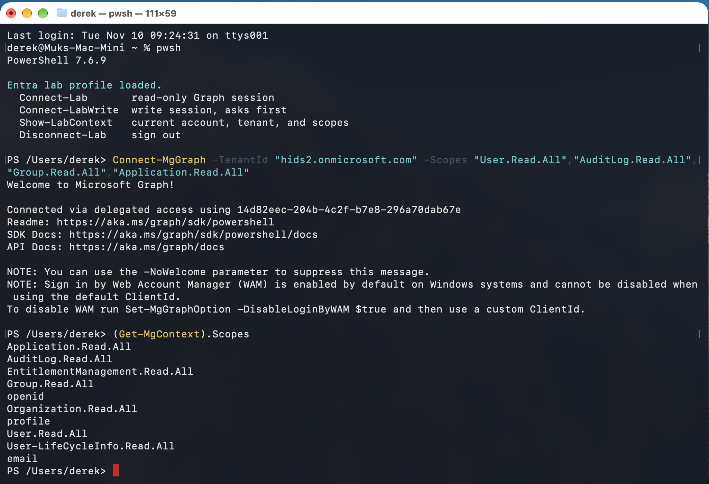 | Asked for 4 read-only scopes, the session held 7. |
| 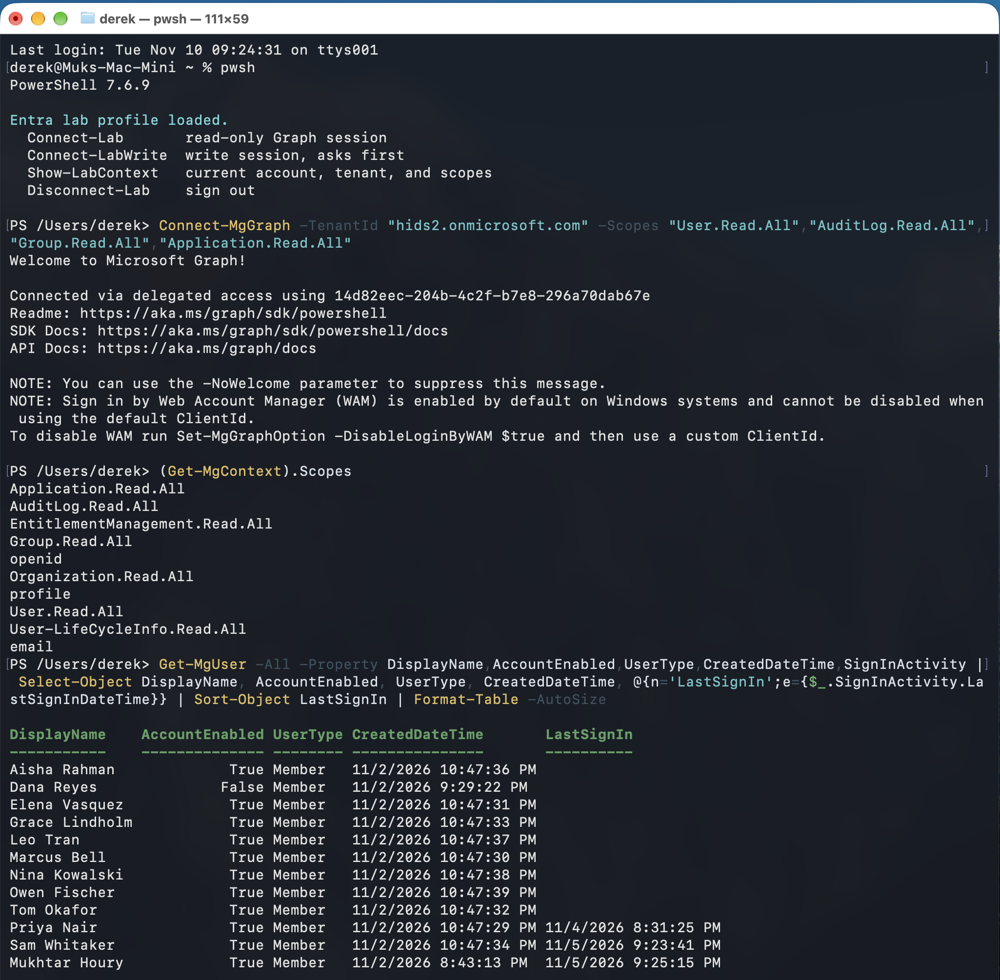 | 9 of 12 users have no last sign-in. |
| 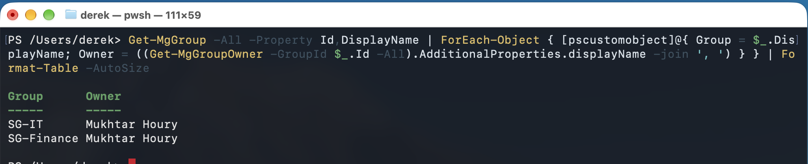 | Before: both groups owned only by the admin. |
| 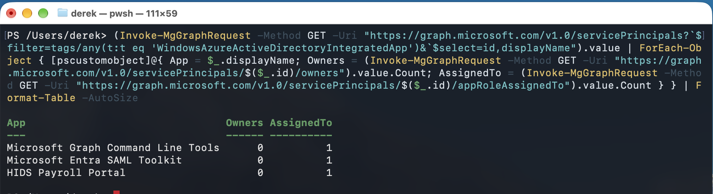 | Before: both custom apps have 0 owners. The Graph PowerShell app is Microsoft's own. |
| 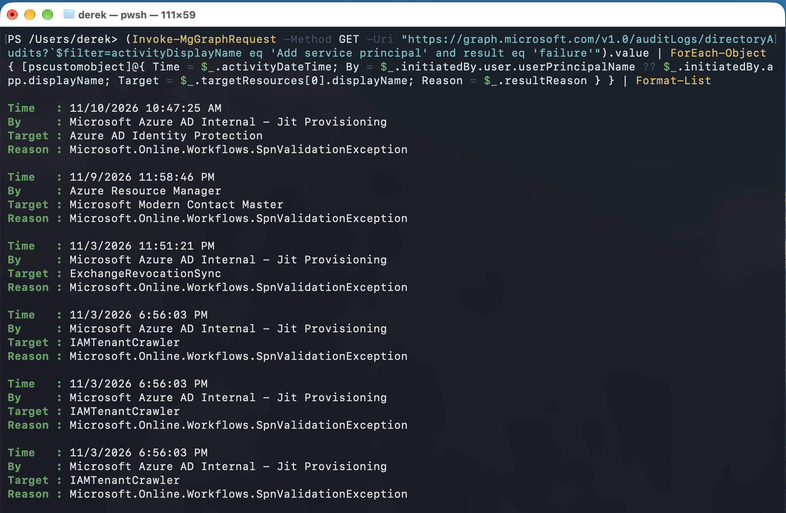 | All 6 failed "Add service principal" events were started by Microsoft services. |
| 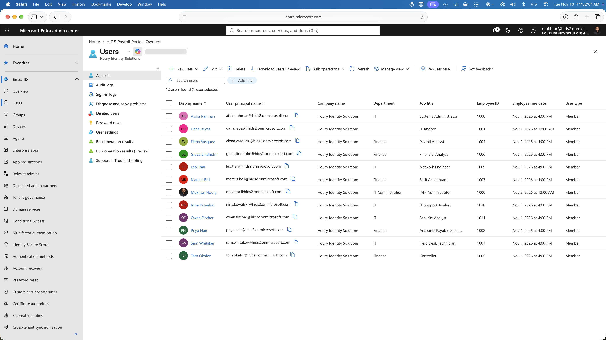 | Job titles used to pick owners, and the inconsistent hire dates. |
| 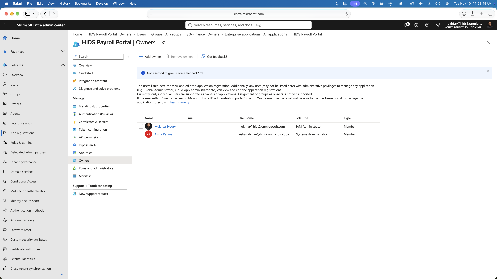 | After: Payroll app registration owned by IT only. |
| 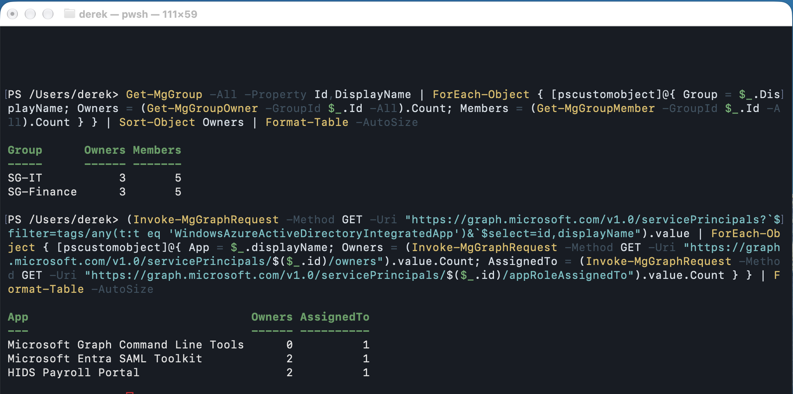 | After: same reports re-run, 3 owners per group and 2 per app. |
| 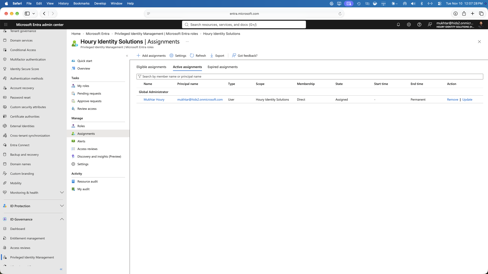 | Before: 1 permanent Global Admin, the everyday account. |
| 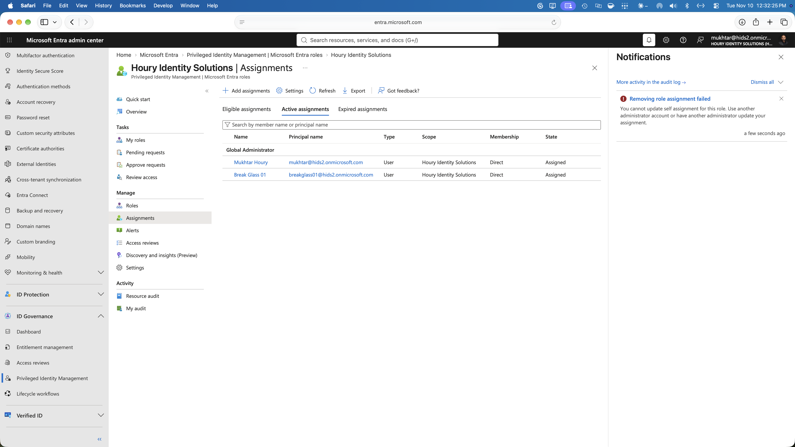 | PIM blocks an admin from removing their own assignment. |
| 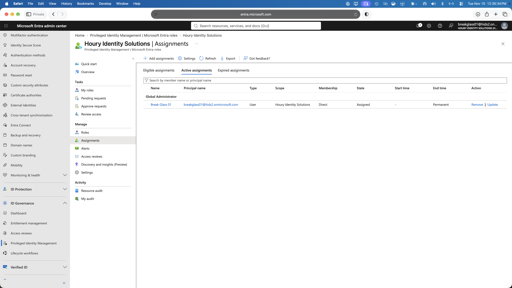 | After: only the break-glass account is permanent. |
| 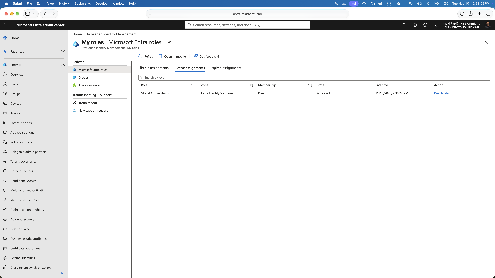 | Just-in-time: Global Admin activated for 2 hours. |
| 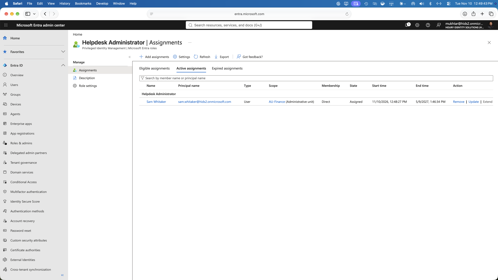 | Help desk role scoped to the Finance administrative unit. |

**Related:** [Privileged Access](../privileged-access/) · [App Consent and Least Privilege](../app-consent-least-privilege/) · [Identity Support](../identity-support/) · [Access Reviews](../access-reviews/)
