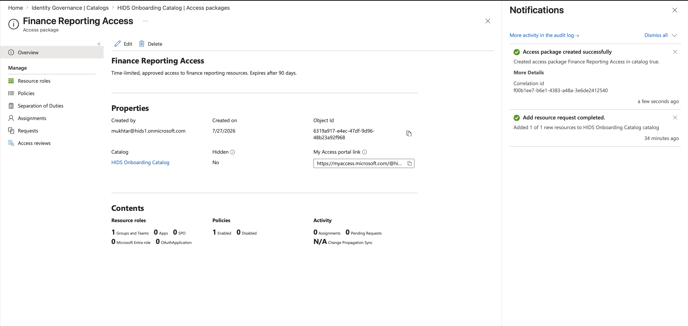
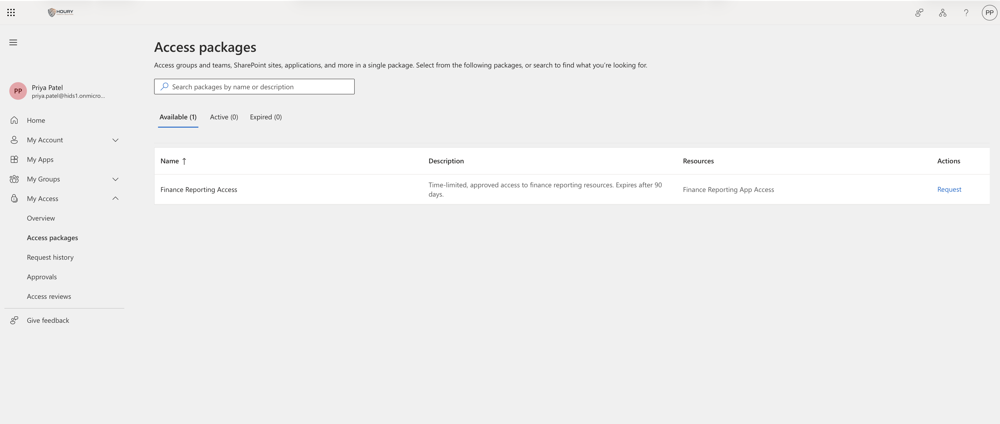
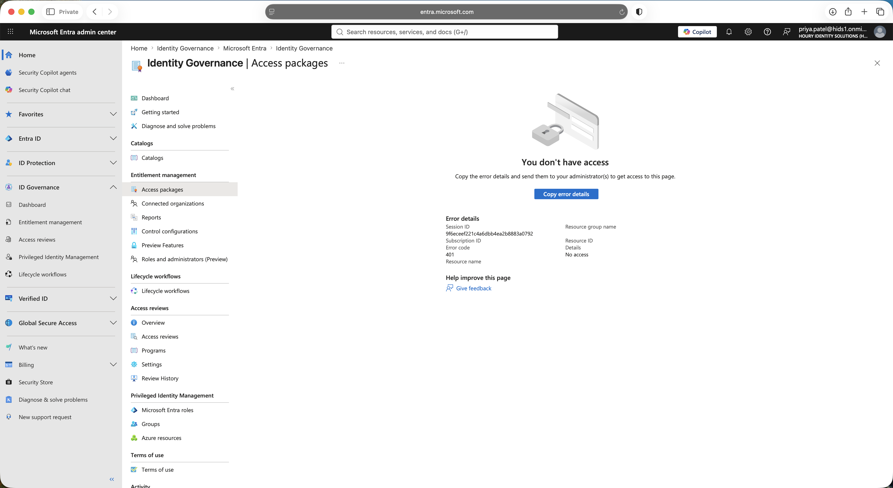
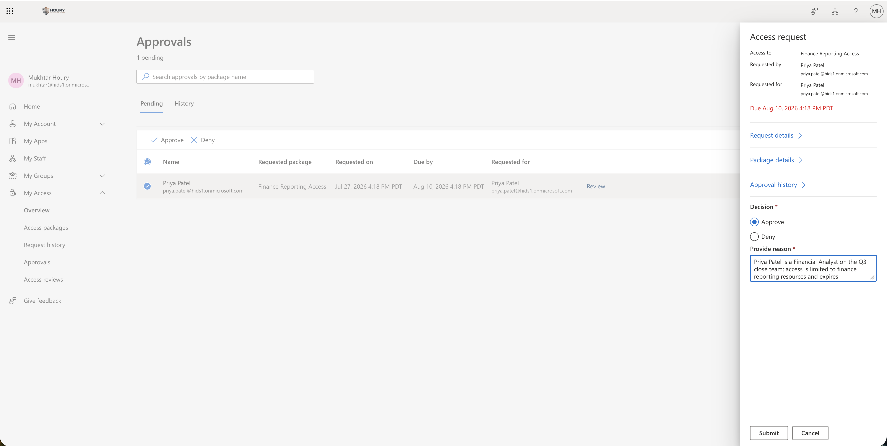
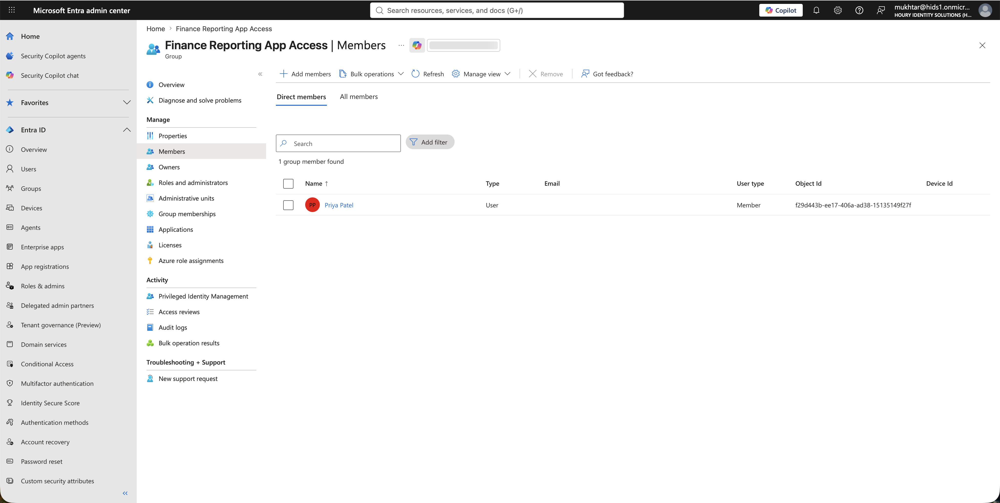

# Access Requests: Approved, Expiring Access Packages

**Built with:** Microsoft Entra ID (P2 + Entra ID Governance) · Entitlement management · My Access portal

Onboarding by hand doesn't scale and leaves no evidence. Someone joins Finance, an admin grants several things from memory, nobody records who approved it or why, and the access never gets removed.

I wanted access to be something a person requests, someone approves, and the system takes away on its own.

All users in this project are fictional and the tenant was built for it. Nothing here is production data.

## The risk

Access granted by hand has no owner and no end date. Two years later nobody can say why someone has it, and nobody is willing to remove it in case it breaks something.

## What I built

A requestable access package for finance reporting:

- **Who can see it:** only members of the Finance department group. The attribute-driven group from [Joiner](../joiner/) decides who is eligible to request. A Finance user sees the package and an IT user sees nothing.
- **Approval:** one stage, a named approver, a required approver justification, and a 14-day decision deadline so requests can't sit forever.
- **Requester justification:** a required business justification question on the request form.
- **Expiry:** access ends after 90 days, and users can't extend it themselves. Access dies on its own unless someone re-requests it and it gets re-approved.
- **Role:** the package grants Member on the resource group, not Owner, so the requester can't manage the group itself.

Then I tested it as a regular user rather than as an admin, because I wanted to see what the process actually feels like from the other side.

## What I found

**The policy enforced itself on the first sign-in.** Signing in as the test user forced MFA registration before she could reach anything, because of the [Conditional Access](../conditional-access/) policy. The admin center returned 401 No access, because she holds no admin role. She found the package in the My Access portal instead.

**Approvers don't work in the admin center.** Approvals happen in My Access, which is the point. Approvers are business managers, not admins.

**The person was never added to the group by hand.** About 8 minutes after she submitted the request, the audit log shows the group membership created by Azure AD Identity Governance, a service, on the strength of an approved request. That's the evidence trail an auditor wants: request, justification, approval, and an automated grant.

**Dynamic groups can't go in an access package.** Entra owns rule-based membership, so a package can't add or remove people from it. I had to create a separate assigned group as the package resource.

**Bulk-created users had no forced password change.** All 13 test accounts were created from a CSV and none were prompted to reset on first sign-in. In a real tenant that's an audit finding.

## What I'd recommend

Put anything sensitive behind a request with approval and an expiry, where the grant is a decision somebody made rather than a value in a field.

Make the approver justification required. It's the field an auditor reads first.

Default to short expiry and make extension a new approval, not a checkbox.

## What I'd do differently in a real environment

The approver would be the requester's manager or the resource owner, not a single named person. I couldn't use manager-as-approver here because no test user had a manager on file, which would have sent every request to the fallback approver.

## Screenshots

| | |
|---|---|
|  | A requestable package scoped to an attribute-driven group, with approval, a decision deadline, and auto-expiry. |
|  | What the requester sees in My Access: only the package her department is eligible for. |
|  | The same user denied at the admin center. She has no admin role. |
|  | The approver records why the access is justified before approving. |
|  | Access granted by the governance engine after approval. Nobody touched the group. |

**Related:** [Access Reviews](../access-reviews/) · [Privileged Access](../privileged-access/) · [Joiner](../joiner/)
