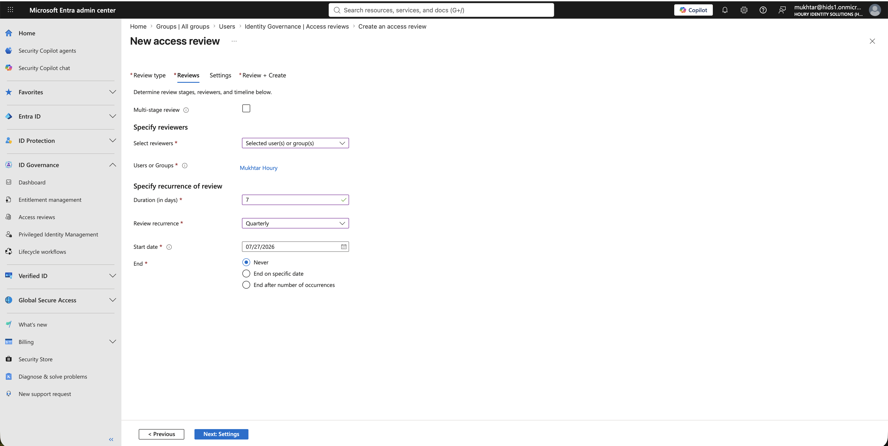
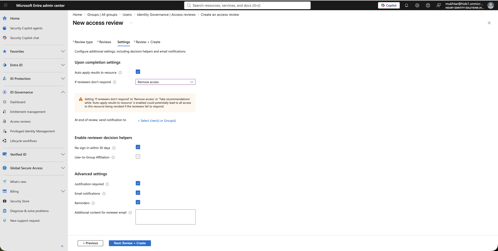
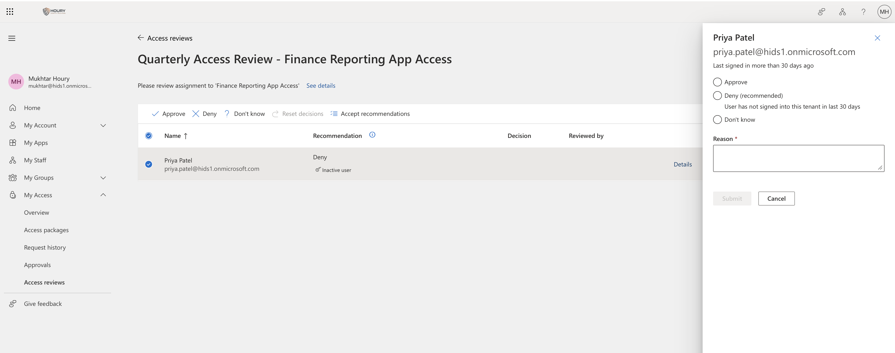
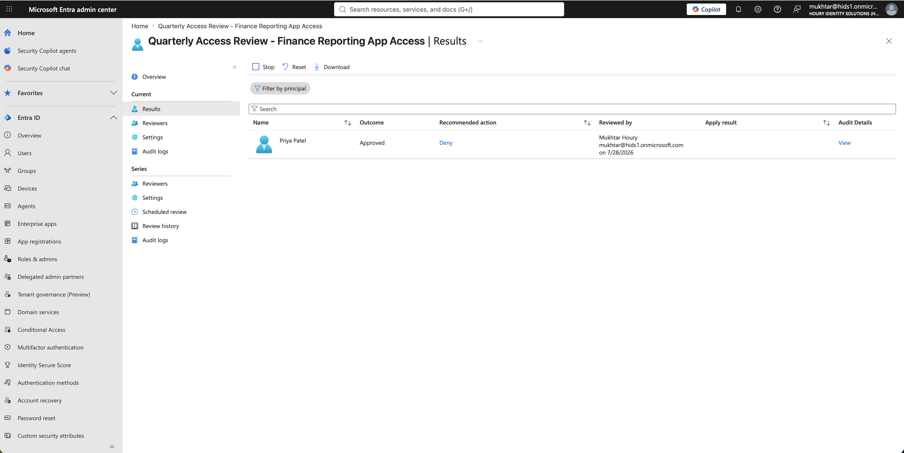

# Access Reviews: Certifying Access, and Not Trusting the Recommendation

**Built with:** Microsoft Entra ID (P2 + Entra ID Governance) · Access reviews · Microsoft Graph

[Access requests](../access-requests/) control how access is granted. Access reviews control whether it's still justified later.

All users in this project are fictional and the tenant was built for it. Nothing here is production data.

## The risk

Someone transfers from Finance to Marketing, keeps the finance access because nobody remembers to remove it, and 2 years later holds permissions from 4 different roles. That's privilege creep, and a recurring review is the control meant to catch it.

The most common way review programs fail is reviewers clicking through. If the system's recommendations are wrong and the reviewer accepts them, the review is worse than nothing, because it produces a clean-looking record.

## What I built

**A recurring quarterly review** of membership in the finance reporting group, with a 7-day window, a named reviewer, required justification, and results applied automatically.

**Fail closed.** If the reviewer doesn't respond, access is removed. Entra shows a warning that this could revoke all access to the resource if reviewers fail to respond, and that's the point. With "No change" you get the audit artifact without the control.

**A tenant-wide review run from Microsoft Graph.** Separately, I reviewed all 24 accounts in the tenant by pulling user attributes, group rules, group membership, licenses and admin roles through Graph instead of clicking through the portal.

## What I found

**The review engine recommends from stale data.** It told me to deny an active user because she "has not signed in within 30 days." She had signed in the day before. I overrode it with a written justification. Sign-in data lags, and the recommendation is calculated when the review starts and never refreshed.

**One button would have revoked her access.** The reviewer toolbar has an "Accept recommendations" button that accepts every recommendation at once. With auto-apply on and no-response set to remove access, one click would have removed a legitimate analyst with no second prompt. Recommendations are a signal, not a decision, and a reviewer clicking through them quickly is rubber-stamping.

**A decision isn't enforcement.** The results showed the decision recorded and the apply result empty. Results are applied when the review instance ends, not when the reviewer clicks.

**The highest-risk findings in the tenant review were people with no access.** 24 reviewed, 14 retained, 8 actions required, 2 revalidations. 4 users matched no group because Active Directory writes "Human Resources" where the group rule expects "HR". Attribute-driven access fails quietly in both directions.

## What I'd recommend

Require a reason on every decision, and treat a reviewer who accepts every recommendation as a finding, not a finished review.

Set reviews to fail closed, and solve the "reviewer was on vacation" problem with more reviewers, not a weaker setting.

Review the attribute values that drive access, not only the memberships they produce. A typo in a department name is an access control failure.

## What I'd do differently in a real environment

The reviewers would be group owners or managers, the people who actually know the person's job. Both options were unusable here because no test user had a manager on file and the group had no owner. Populate those fields, or half of Entra's governance features can't be used.

## Evidence

- [`access-review-2026-Q3.md`](evidence/access-review-2026-Q3.md): findings and recommended actions from the tenant-wide review.
- [`access-review-2026-Q3.xlsx`](evidence/access-review-2026-Q3.xlsx): the workbook, with an overview, per-user review, findings, and a remediation tracker.

## Screenshots

| | |
|---|---|
|  | Quarterly recurrence with a 7-day window. |
|  | No response means access is removed. Entra warns that this could revoke everyone, which is the point. |
|  | The engine recommended Deny for a user who had signed in the day before. |
|  | The admin view: outcome Approved next to recommended action Deny, with the reviewer's justification on record. |

**Related:** [Access Requests](../access-requests/) · [Privileged Access](../privileged-access/) · [Mover](../mover/)
