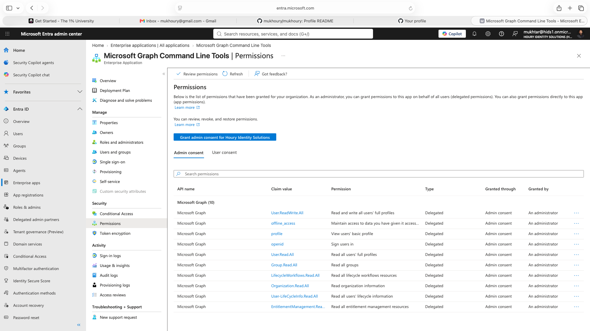
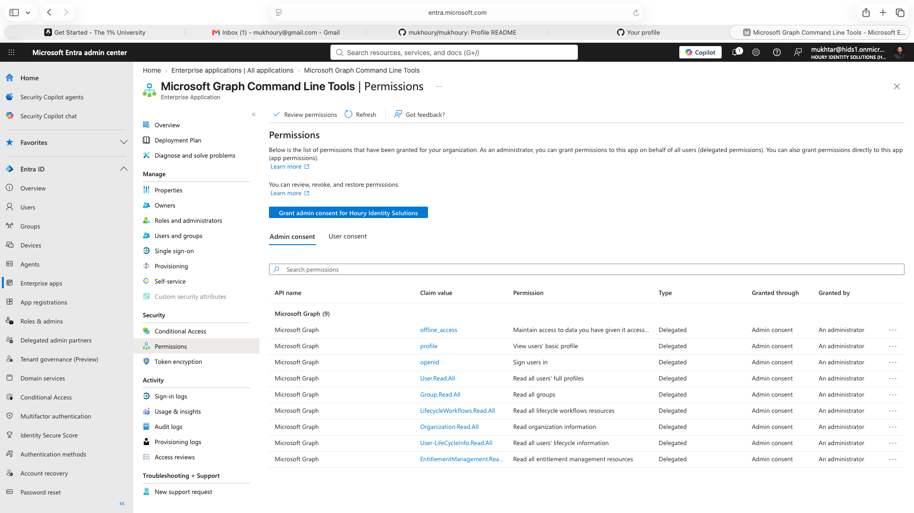
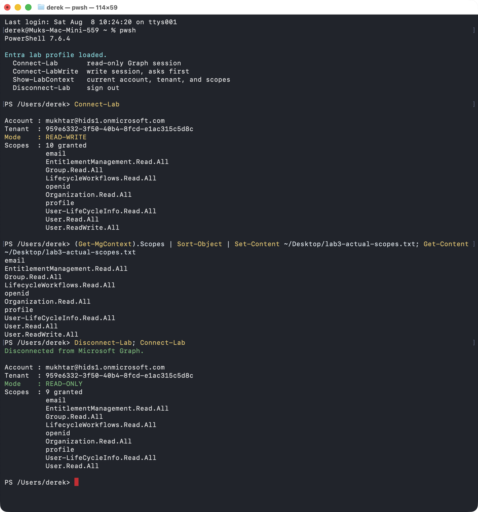

# App Consent and Least Privilege: Asking for Read-Only Doesn't Get You Read-Only

**Built with:** Microsoft Graph PowerShell SDK · Microsoft Graph API · Entra ID enterprise applications · PowerShell 7

While building the [leaver detection script](../leaver/), I connected to Microsoft Graph asking for read-only permissions. What I got was something else.

All users in this project are fictional and the tenant was built for it. Nothing here is production data.

## The risk

If the person running a check has more permission than they think, that's an exposure. Applications hold permissions too, and an application that was granted admin consent once keeps that permission for everyone who uses it, long after anyone remembers why.

## What I built

I connected the Microsoft Graph PowerShell SDK with 6 read scopes, compared the permissions the session actually held against what I requested, traced the difference back to the application's consent grants, and revoked the one that didn't belong.

## What I found

**Asking for read-only doesn't get you read-only.** I connected with 6 read scopes and got a session with 10, including tenant-wide write on every user in the directory. The token carries whatever the application has already been consented for, not what I asked for today. Every piece of least-privilege advice I'd read treats that scope parameter as a limit. It's a request.

**The cause was a standing admin consent grant.** The shared Graph application held 10 delegated permissions, every one granted through admin consent, including one I never asked for.

**I revoked the standing grant.** 10 permissions down to 9, and the next write session triggered a real consent prompt instead of connecting silently. It's the same argument PIM makes for people, applied to an application: write access requested at the moment of need instead of held permanently. See [Privileged Access](../privileged-access/).

## What I'd recommend

Audit what your tooling actually holds rather than what it requested. A standing admin consent grant on a shared application quietly governs every session anyone opens with it.

Review enterprise application consent grants the same way you review user access, with an owner and a review date.

## What I'd do differently in a real environment

Scheduled scripts would run as their own service principal with certificate authentication and only the application permissions they need, not as a person through a shared application.

## Screenshots

| | |
|---|---|
|  | The root cause. 10 delegated permissions on the shared Graph application, every row granted through admin consent, including one I never asked for. |
|  | 10 permissions down to 9, every remaining entry a read or sign-in scope. |
|  | Same command, same account, minutes apart. Read-write with 10 scopes, then read-only with 9. |

**Related:** [Leaver](../leaver/) · [Privileged Access](../privileged-access/)
