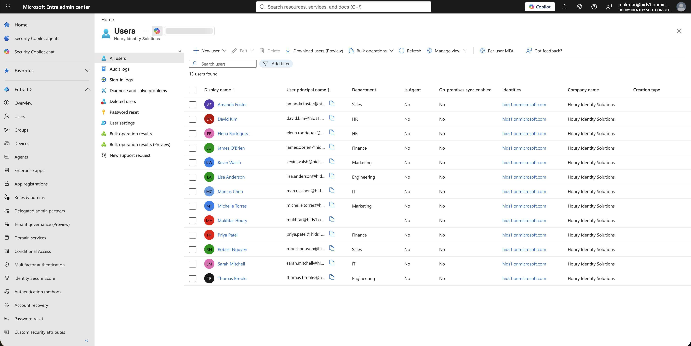
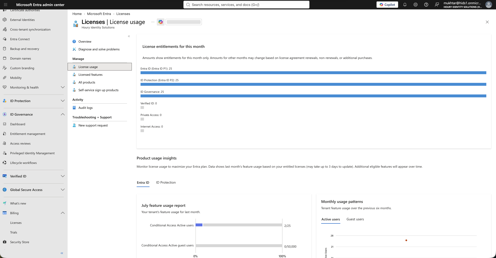
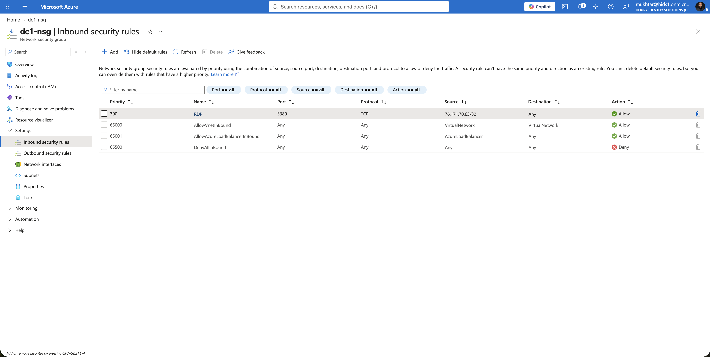
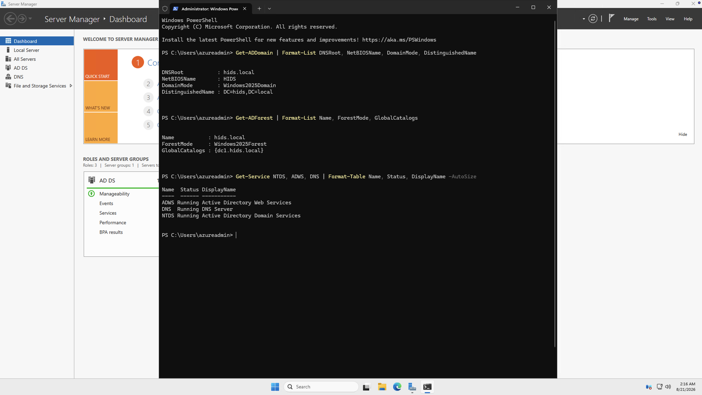
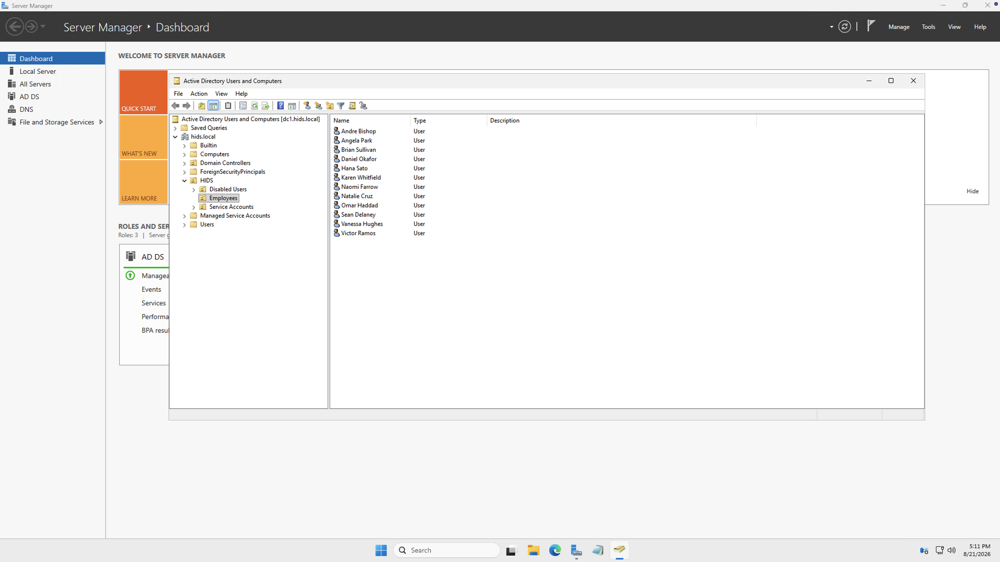

# Architecture and Environment

Everything in this portfolio was built in 2 environments that I set up and ran myself.

All users are fictional and both environments were built for this portfolio. Nothing here is production data.

## Environment 1: Cloud-only Microsoft Entra ID tenant

- **Tenant:** `hids1.onmicrosoft.com`
- **Licensing:** Microsoft Entra ID P2, plus an Entra ID Governance trial for Lifecycle Workflows
- **Identities:** fictional employees across 6 departments (Engineering, Finance, HR, IT, Marketing, Sales), created in bulk from a CSV
- **Used for:** [Joiner](../joiner/), [Leaver](../leaver/), [Access Requests](../access-requests/), [Access Reviews](../access-reviews/), [Privileged Access](../privileged-access/), [Conditional Access](../conditional-access/), [App Consent and Least Privilege](../app-consent-least-privilege/)

**Licensing is a design constraint.** Lifecycle Workflows returned 401 until the tenant held an Entra ID Governance license. I set the trial to renew for 1 month rather than the 1-year default, so a finished test environment wouldn't turn into a bill.

## Environment 2: Hybrid identity (on-premises Active Directory synced to Entra ID)

- **Domain controller:** Windows Server 2025 on an Azure virtual machine (Standard_D2s_v3)
- **Directory:** a new Active Directory forest, `hids.local`, with an alternate UPN suffix matching the cloud domain so users can sign in with the same name in both places
- **Sync:** Microsoft Entra Connect Sync, custom install, password hash sync with seamless single sign-on, scoped to one organizational unit
- **Identities:** 13 employees and 2 service accounts, in separate organizational units
- **Used for:** [Directory Sync](../directory-sync/), [Mover](../mover/), [Leaver](../leaver/)

**Security and cost controls on the server itself:**

- Remote Desktop scoped to my own IP address. Azure created the rule open to the entire internet, and I closed it right after
- Private IP pinned to static, because a domain controller's address can't change under DNS
- Auto-shutdown every night as a cost backstop

The environment was deleted once the work was finished. Keeping a finished test environment running costs money and adds nothing.

## Build scripts

The domain controller build is scripted so it can be reproduced:

1. [`1-install-adds-role.ps1`](scripts/1-install-adds-role.ps1): installs the Active Directory Domain Services role
2. [`2-promote-dc.ps1`](scripts/2-promote-dc.ps1): promotes the server to the first domain controller in a new forest
3. [`3-seed-directory.ps1`](scripts/3-seed-directory.ps1): creates the organizational units, employees and service accounts

## Tools

| Tool | Role |
|---|---|
| Microsoft Entra ID (P2 + ID Governance) | Cloud directory, dynamic groups, Conditional Access, PIM, access packages, access reviews, Lifecycle Workflows |
| Active Directory Domain Services | On-premises directory and source of authority in the hybrid environment |
| Microsoft Entra Connect Sync | Synchronization from Active Directory to Entra ID |
| Microsoft Graph PowerShell SDK | Detection scripts, access review data, consent auditing |
| Microsoft Azure | Hosting for the domain controller |

## Screenshots

| | |
|---|---|
|  | The cloud tenant's users. |
|  | The Entra ID Governance trial assigned, which unblocked Lifecycle Workflows. |
|  | Remote Desktop restricted to a single source address. |
|  | The domain controller promotion verified from PowerShell. |
|  | The on-premises employee roster before sync. |

**Related:** [Directory Sync](../directory-sync/)
