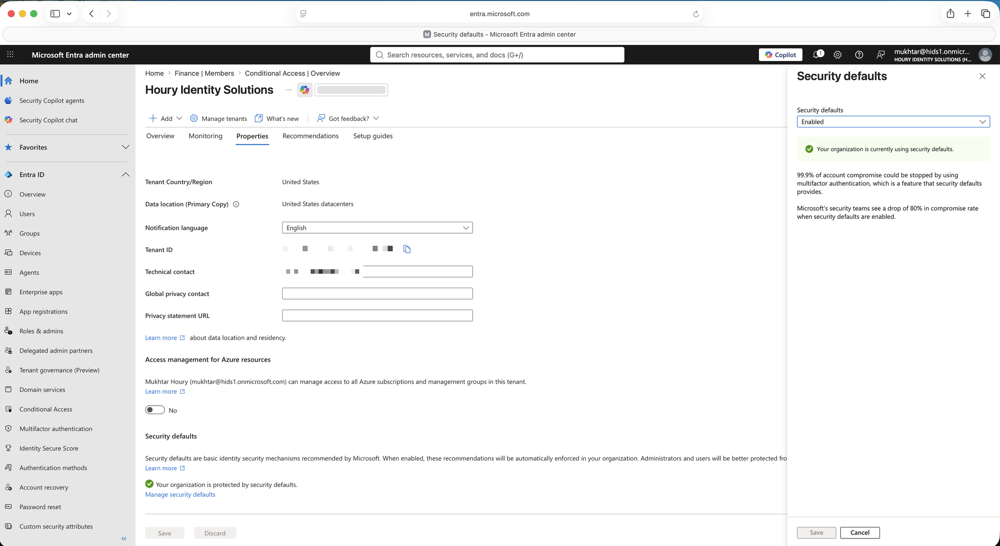
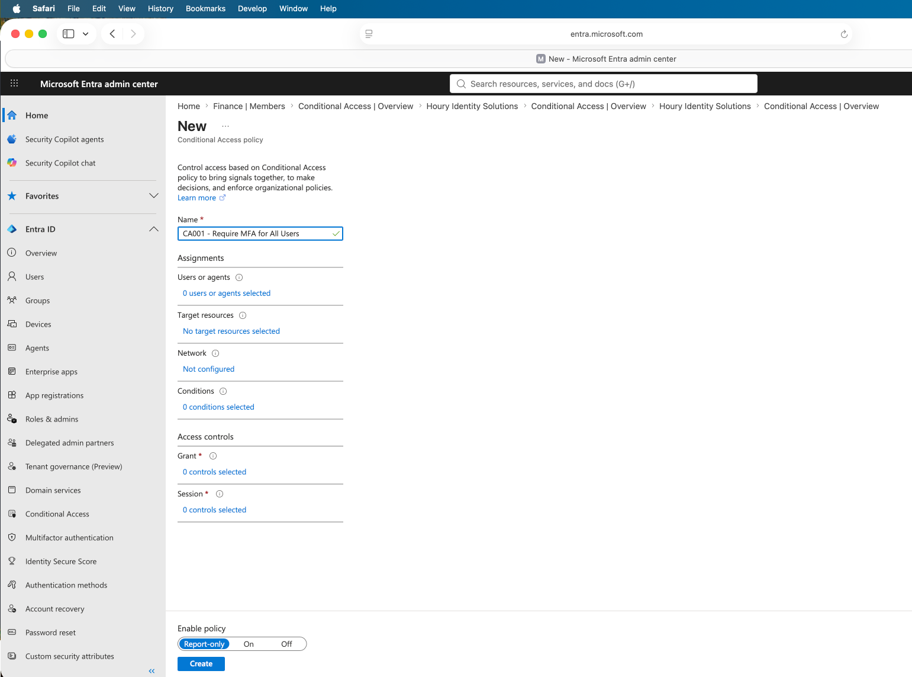
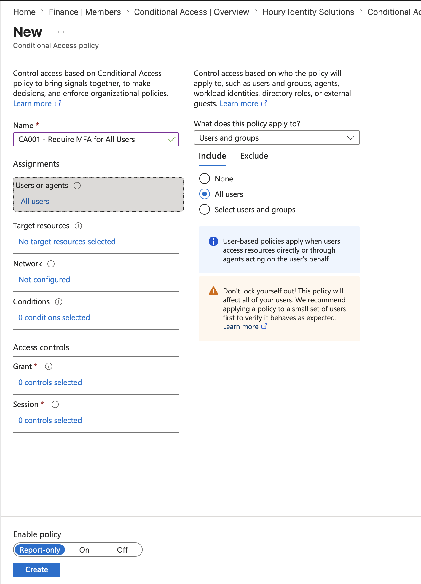

# Conditional Access: Requiring MFA Without Locking Out the Tenant

**Built with:** Microsoft Entra ID (Premium P2) · Conditional Access

The first thing most tenants need is MFA for everyone. The first thing that can go wrong is a policy that locks every administrator out with no way back in.

All users in this project are fictional and the tenant was built for it. Nothing here is production data.

## The risk

Lock down authentication carelessly and you can lock every administrator out of the tenant with a single policy and no way back in.

## What I built

I turned off Security Defaults and replaced it with a Conditional Access policy requiring MFA for all users and all resources, with one administrator account deliberately excluded as a break-glass account.

## What I found

**Security Defaults has to come off first.** It enforces MFA, but it has no conditions and no exclusions, so you can't create a break-glass account while it's on. Turning off a security feature felt wrong until I understood it's a floor, not a control.

**The exclusion is the entire point.** A policy that requires MFA for all users, applied to all users including you, can lock every administrator out of the tenant. The excluded break-glass account is the standard safeguard, and it's the first thing I'd check on any tenant I inherited.

**The policy enforced itself on real sign-ins.** When I later signed in as a regular test user to request access, she was forced to register for MFA before she could reach anything. See [Access Requests](../access-requests/).

## What I'd recommend

Never deploy a tenant-wide Conditional Access policy without a documented break-glass account excluded from it, and check that exclusion exists on any tenant you inherit before you change anything else.

## What I'd do differently in a real environment

I'd layer the policies rather than running one blanket rule: block legacy authentication, require compliant devices for admin roles, and add risk-based conditions. One policy requiring MFA for everyone is a floor, not a finished design.

The break-glass account would be one of at least 2 cloud-only emergency accounts, with credentials held offline and sign-ins alerted on.

## Screenshots

| | |
|---|---|
|  | Before: Security Defaults enabled, with no way to add exclusions. |
|  | Security Defaults disabled, the prerequisite for Conditional Access to take over. |
|  | MFA required for all users and all resources, with the admin account routed to Exclude. |

**Related:** [Privileged Access](../privileged-access/) · [Access Requests](../access-requests/)
