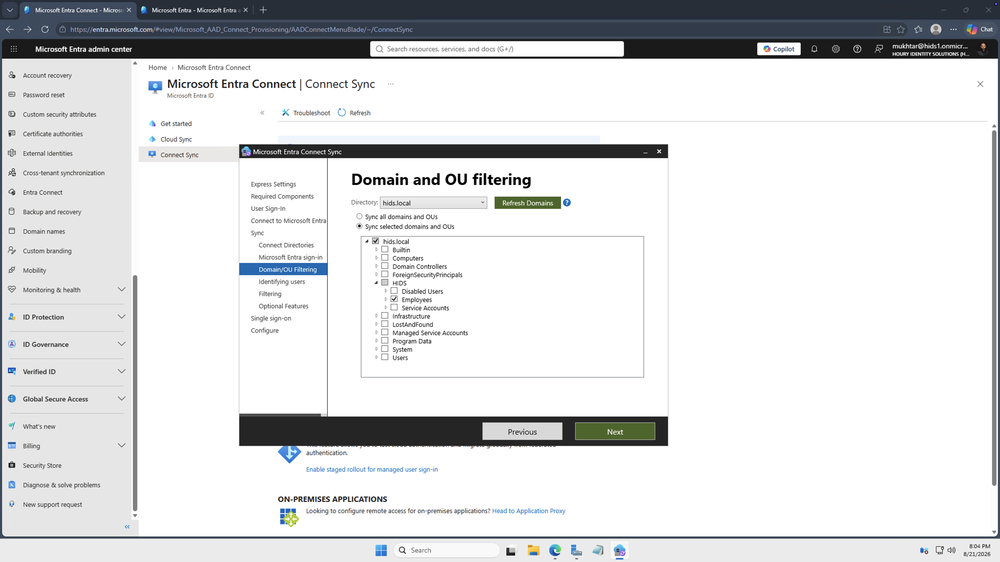
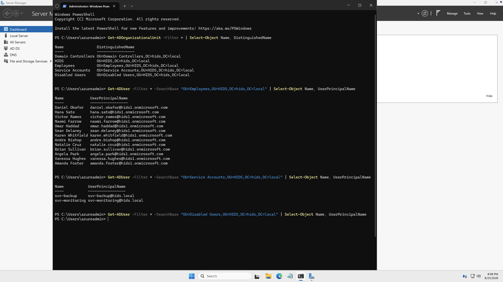
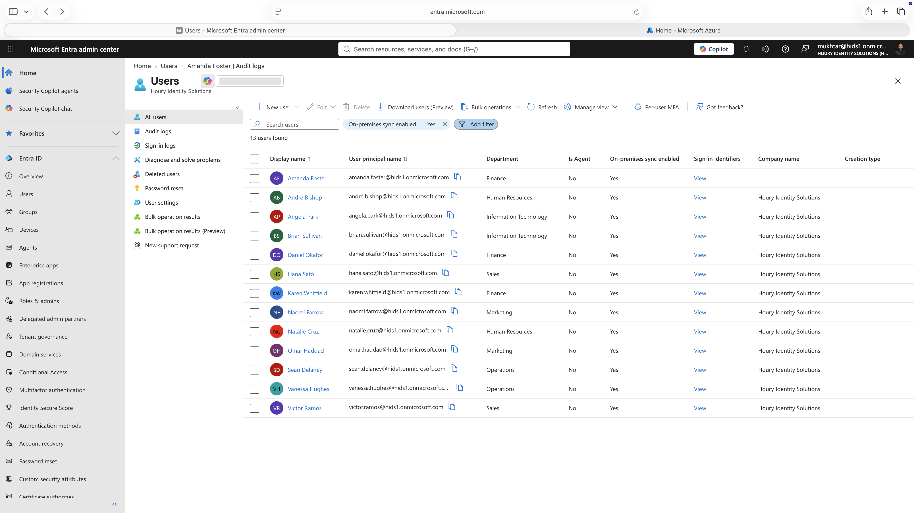
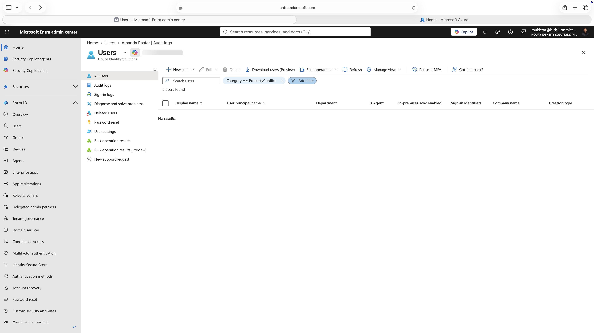
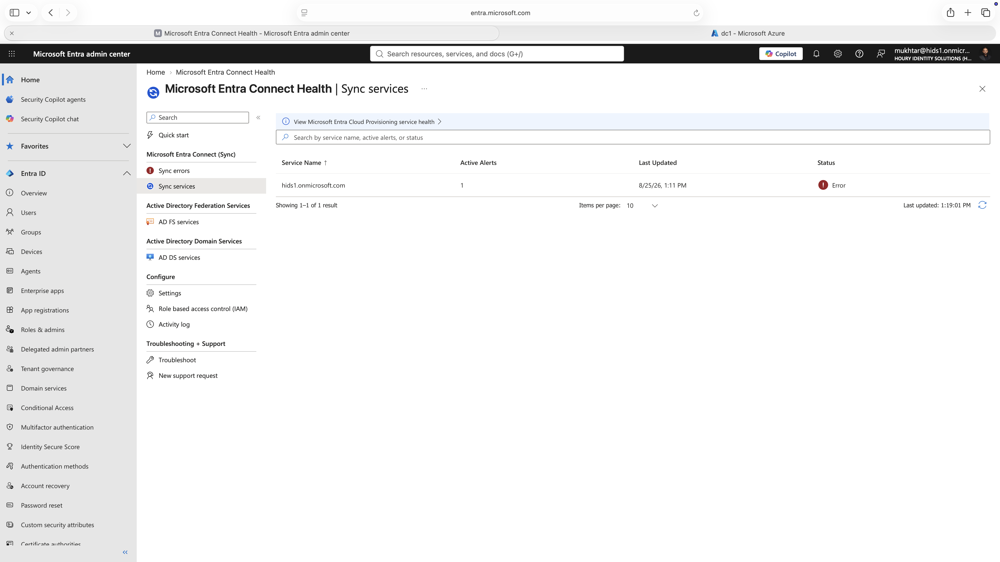

# Directory Sync: Hybrid Identity and What the Cloud Can't See

**Built with:** Windows Server 2025 · Active Directory Domain Services · Microsoft Entra Connect Sync · Microsoft Entra ID P2 · PowerShell

Most companies don't run a cloud-only directory. They have an on-premises Active Directory that has been there for years and a cloud directory that showed up later, and the on-premises one is usually in charge.

I built that setup myself and then broke it on purpose to see what the cloud can and can't tell you.

All users in this project are fictional and the environment was built for it. Nothing here is production data.

## The risk

Two directories and one person. Every place they exist twice is a place something can be missed, and the gap between the two is where access survives a termination.

The on-premises side is edited by people who never sign into the cloud, and the cloud side is where access actually gets granted. A change made in one system produces effects in another system the person making it can't see.

## What I built

An Active Directory forest on a Windows Server domain controller, synced into my Entra ID tenant with Entra Connect Sync. The build itself is in [Architecture and Environment](../architecture-and-environment/).

I used a `.local` domain name on purpose, because that's what a lot of real companies are stuck with and it forces you to deal with the sign-in name (UPN) problem instead of avoiding it. I ran the custom install instead of Express so I had to actually choose the sign-in method and the sync scope rather than letting the wizard decide.

I scoped the sync to one organizational unit and deliberately left 2 service accounts outside it, so there would be something real to go looking for later.

15 accounts on-premises. 13 made it to the cloud.

## What I found

**Nothing in the cloud can tell you what didn't sync.** Those 2 service accounts don't exist in Entra, so there's no row to filter on and no error to find. The provisioning error report works fine and returns zero, because leaving something out of scope isn't a failure. Entra says 13 users synced and has no way to tell you 13 out of what. I had to log into the domain controller to get that number.

**Sync scope decides which identities exist in the cloud at all.** Moving one account into a folder outside the scope deleted its cloud identity with no warning. That's written up in [Leaver](../leaver/).

**Two Microsoft consoles gave me opposite answers.** The Entra Connect page said sync status Enabled with no warning while my domain controller had been powered off overnight. Connect Health said Error on the same server after it came back and was syncing fine. Neither one was reporting on what it looked like it was reporting on.

**The on-premises side is in charge.** Once an account syncs, its attributes are edited in Active Directory, not the cloud, and those attributes drive cloud access. See [Mover](../mover/) for what that does to a role change.

## What I'd recommend

Reconcile the two directories on a schedule and alert on the difference. No console can see both sides, so the comparison has to be built. That's the only control that produces a count you can trust.

Treat synchronization scope as an access control with a documented owner and a review date.

Don't trust a single health dashboard. Check sync status against the source.

## What I'd do differently in a real environment

I'd want the excluded service accounts covered by something. Keeping them out of the cloud is defensible, but it means they're outside Conditional Access, access reviews, and risk detection, and that trade needs a compensating control on-premises rather than being an accident of a filter.

## Screenshots

| | |
|---|---|
|  | The sync scoped to the Employees organizational unit only. |
|  | Read straight from the domain controller. 13 employees, 2 service accounts, 0 in the disabled container. 15 exist, 13 reached the cloud. |
|  | The cloud side: 13 synced users, with no way to know what's missing. |
|  | The provisioning error report returns zero. Out of scope isn't an error. |
|  | Connect Health reporting Error on the same server the Connect Sync page called Enabled. |

**Related:** [Architecture and Environment](../architecture-and-environment/) · [Mover](../mover/) · [Leaver](../leaver/)
