# Identity Support: Tickets From Lost Phones to Lockouts

**Built with:** Microsoft Entra ID (Premium P2) · Conditional Access · Microsoft Graph PowerShell SDK

Most IAM work isn't architecture. It's tickets: a new hire who needs access by Monday, a transfer, a termination that has to happen right now, a user who lost their phone, an app that says "you're not allowed." I built a fresh tenant (Houry Identity Solutions) and worked the common ones end to end, then went back through the logs to prove what actually happened.

All users in this project are fictional and the tenant was built for it. Nothing here is production data.

## The risk

Every one of these tickets can be closed with a green checkmark while the problem is still there. A disabled account can keep its access. A transfer can quietly drop a license. An MFA reset can hand an attacker a new sign-in method. And "Failure" in a sign-in log can mean 2 completely different things.

## What I built

- **Joiner, mover, leaver.** Dynamic groups by department with group-based licensing, a transfer from Finance to IT, a termination, and 10 joiners created from a CSV with a PowerShell script ([scripts/](scripts/)).
- **MFA and password support.** A lost-phone reset using a one-time Temporary Access Pass, a self-service password reset (SSPR) pilot scoped to one group, and a report-only Conditional Access policy tested with the What If tool.
- **App access.** A SAML app (Microsoft Entra SAML Toolkit) with working single sign-on, an OIDC app registration, and "assignment required" turned on so only one group can get in.
- **Troubleshooting from logs.** I locked a test account out on purpose, then traced it through the sign-in logs and the audit log.

## What I found

**Disabling an account doesn't remove its access.** After the termination the user was disabled with sessions revoked, and still held a group and a paid license until I cleared the attributes driving them. I used a PowerShell report to confirm it was clean before calling it done.

**A transfer can remove a license with no error.** I moved a user from a group that carried a license to one that didn't. The group change worked in about a minute and the license was just gone. On a mover ticket I now check that the destination group carries the access the person needs, not only that the groups changed.

**The lost phone is the reason you delete the old method.** The order matters: verify the caller, delete the lost phone's Authenticator, revoke sessions, and only then issue the pass. That way the lost phone and the new pass are never valid at the same time. The pass was set to one-time, and the user's methods page shows "One time used" after she registered her new phone.

**A pilot isn't tested until it fails for the right people.** The SSPR pilot worked for a Finance user in about 2 minutes. An IT user got "password reset isn't turned on for your account," which is the result I wanted.

**Assignment, SSO and Conditional Access are 3 separate doors.** Assignment decides who can get to the app. SSO decides how they get in. Conditional Access decides what they have to prove first. An unassigned user was blocked with AADSTS50105, and the error said why: not a direct member of the assigned group. Nested groups don't count.

**Failure in the sign-in log is not an answer.** I locked the account with 12 wrong passwords. The first 4 were the same password typed again, and smart lockout ignored those (it's designed so a stale saved password can't lock a real user out). The log showed 15 failures. Most were 50126, a bad password. The last was 50053, account locked. Only opening the row tells you which.

**The lockout never showed up in the audit log, and that's correct.** Nobody changed anything in the directory. The proof of who locked the account is the run of 50126 rows from that user. The audit log did show the earlier admin password reset, as several rows across 2 services, including the refresh-token revoke that comes with it.

**Cloud-only accounts have no unlock button.** If you came from Active Directory this is a surprise. The lock clears on its own after 60 seconds by default, or a password reset clears it.

**The portal will lie to you about time.** The default filter is Last 24 hours, and it hid the previous day's events from me twice. Sign-in logs also lagged by 12 minutes at one point. Check the time window before deciding a sign-in never happened.

## What I'd recommend

- Close leaver tickets on evidence, not on the disable. Run a report that lists disabled users still holding groups or licenses.
- On every mover ticket, compare access before and after. A silent license drop looks like success.
- Never issue a Temporary Access Pass before the old method is gone and the caller is verified through something on file. "I lost my phone" is the classic social engineering opener.
- Teach the service desk to open the sign-in row and read the error code before they touch anything.

## What I'd do differently in a real environment

The SSPR pilot used 1 method so I could test the flow. Production would require 2, so one stolen device can't reset a password.

I'd also work the on-premises side of these tickets: password resets, unlocks and group changes in Active Directory, then confirm they sync. I covered sync separately in [Directory Sync](../directory-sync/), but in a hybrid tenant a lot of these tickets start in AD, not Entra.

## Screenshots

| | |
|---|---|
| 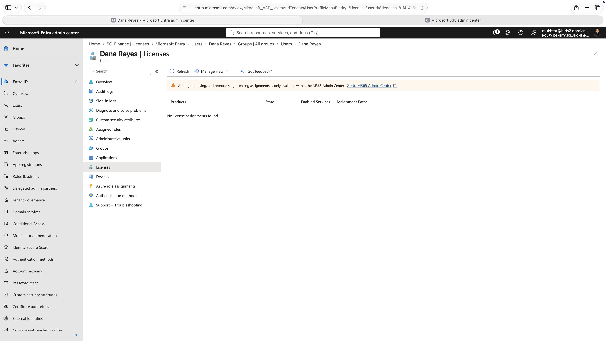 | Mover: after the move to IT, the license is gone and no error was raised. |
| 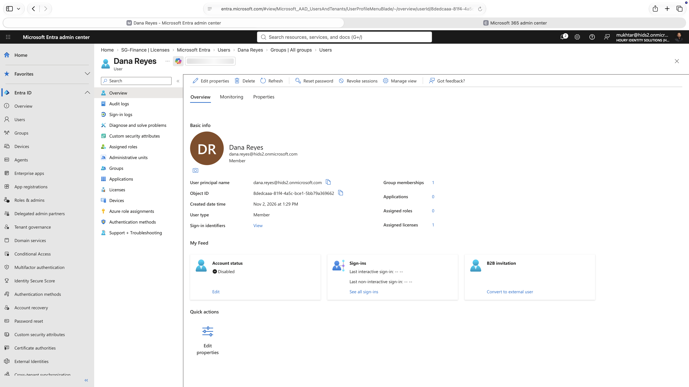 | Leaver: account disabled, still holding 1 group and 1 license. |
| 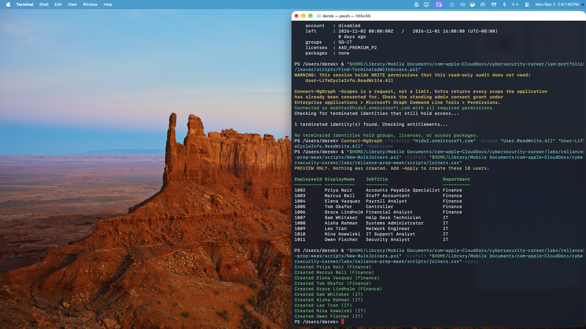 | 10 joiners created from a CSV with Microsoft Graph PowerShell. |
| 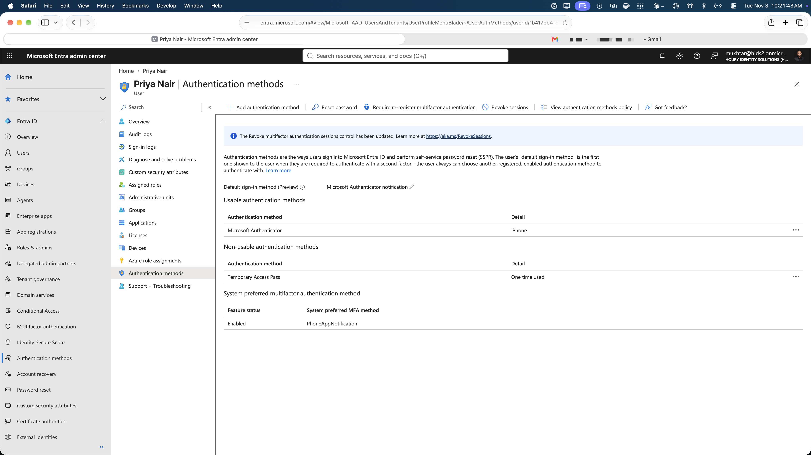 | Lost phone: new Authenticator registered, Temporary Access Pass shows "One time used." |
| 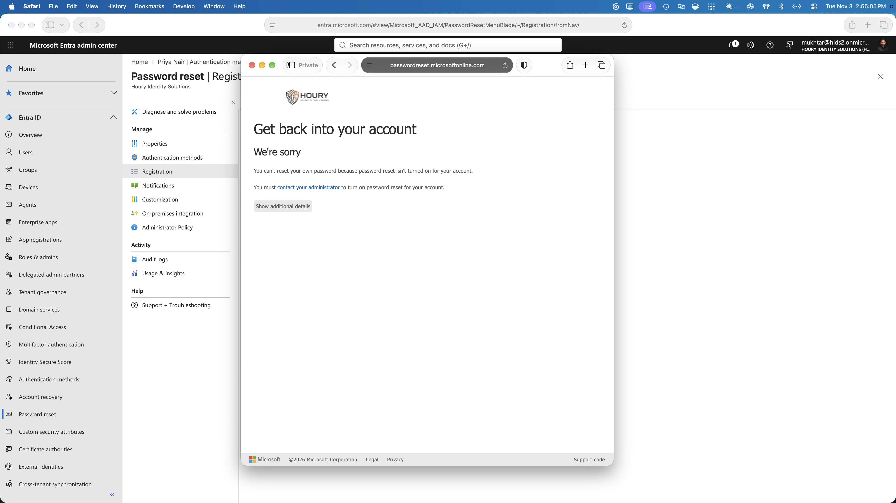 | SSPR pilot: a user outside the pilot group is refused. |
| 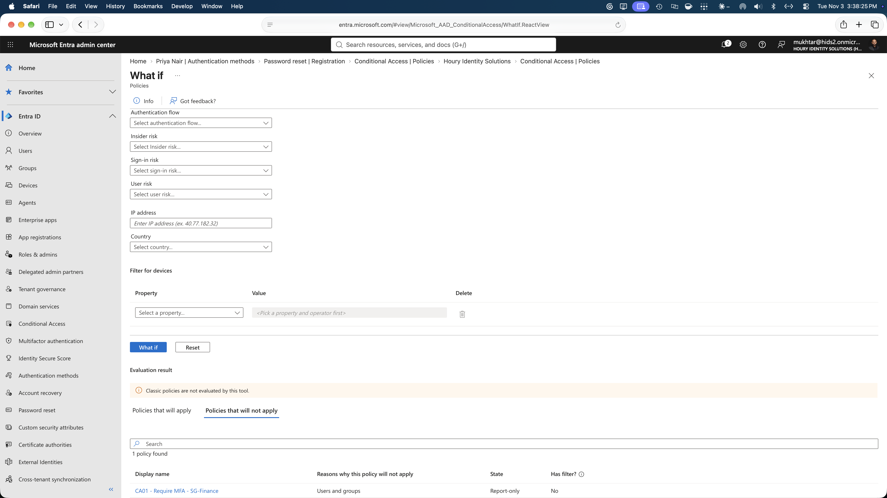 | What If: why the MFA policy doesn't apply to a user outside the target group. |
| 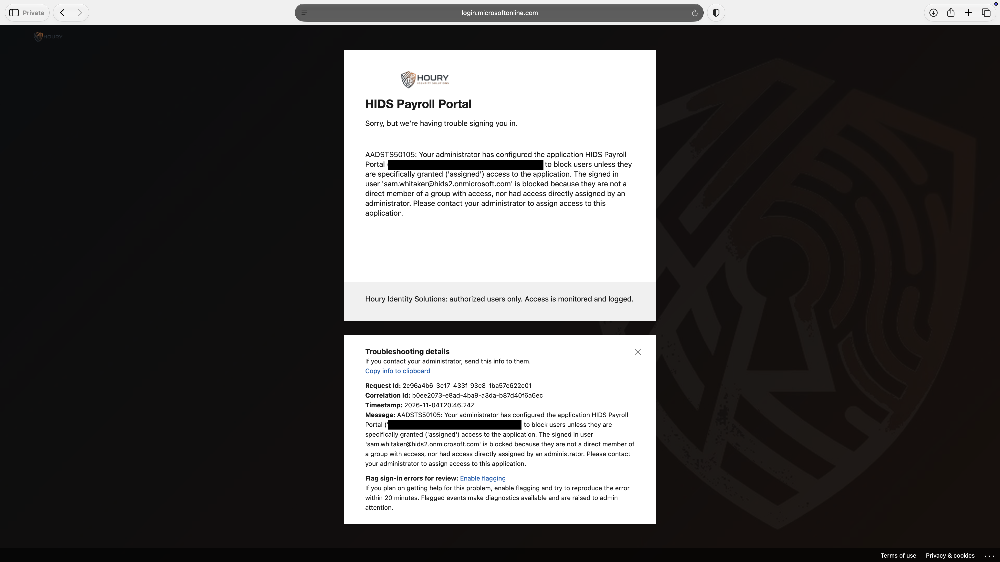 | App access: unassigned user blocked with AADSTS50105. |
| 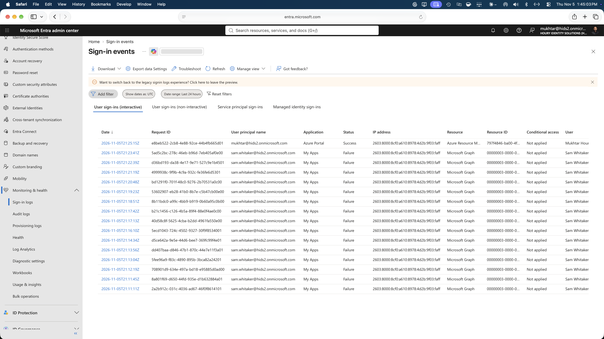 | Sign-in log: 15 failures for the locked account. |
| 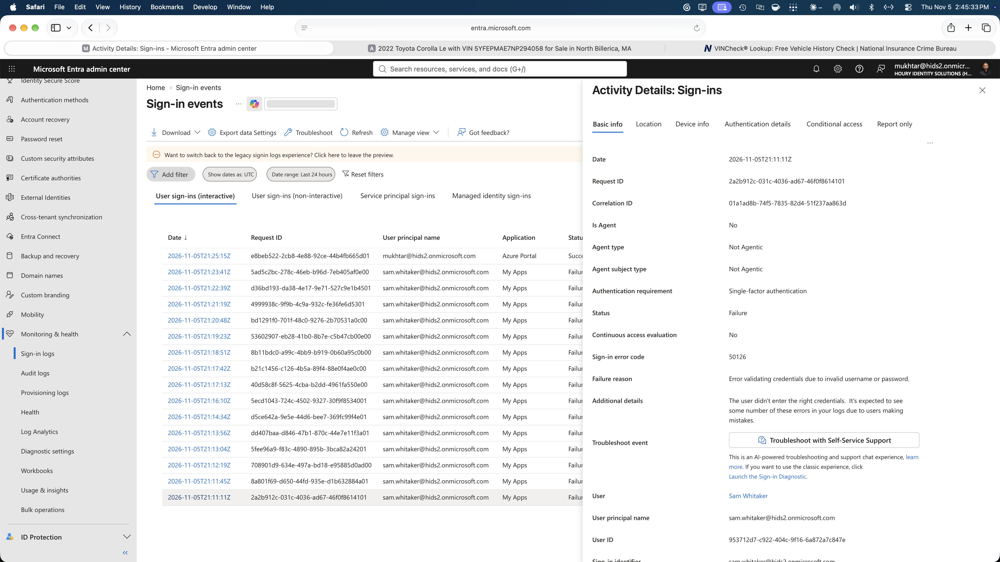 | Row detail: 50126, invalid username or password. |
| 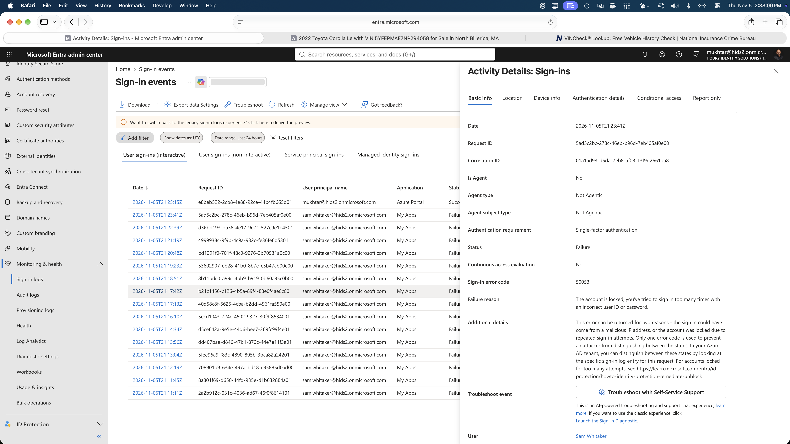 | Row detail: 50053, account locked. |
| 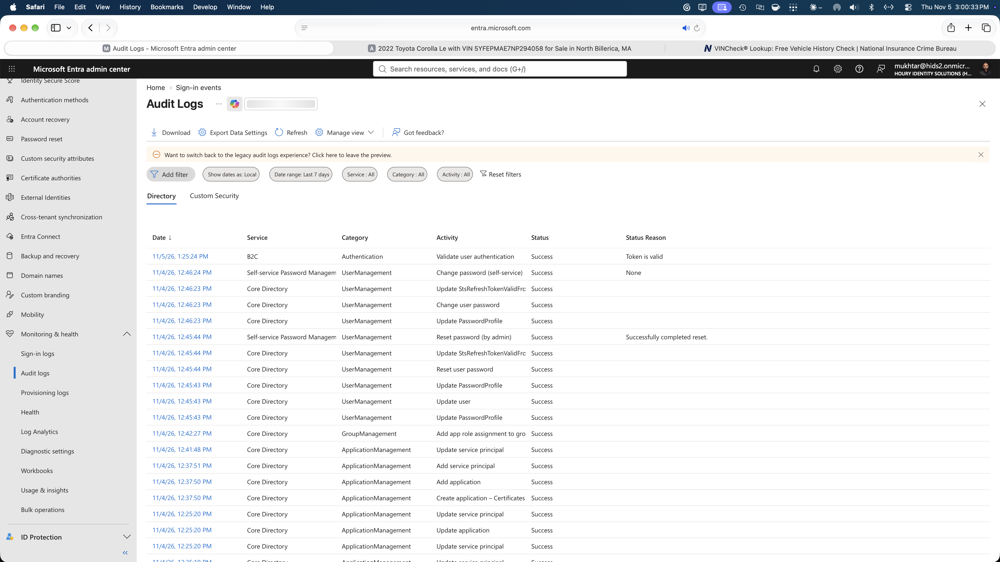 | Audit log: one admin password reset written as several rows across 2 services. |

**Related:** [Leaver](../leaver/) · [Conditional Access](../conditional-access/) · [App Consent and Least Privilege](../app-consent-least-privilege/)
