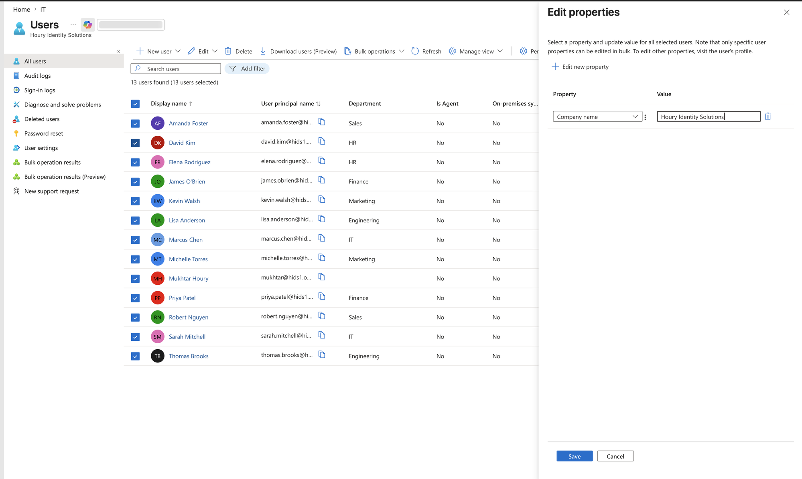
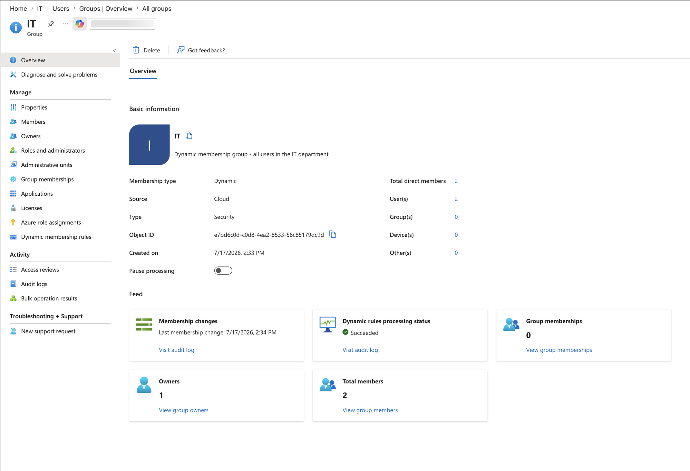
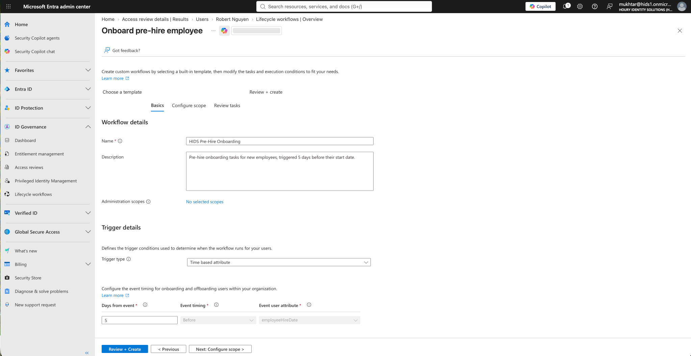
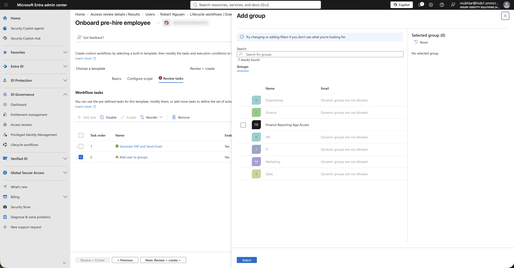
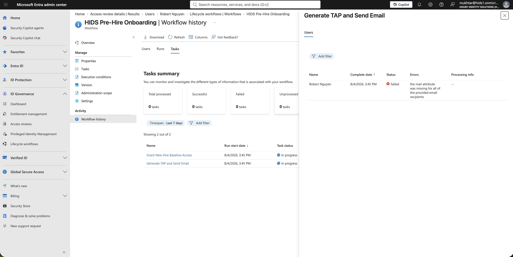
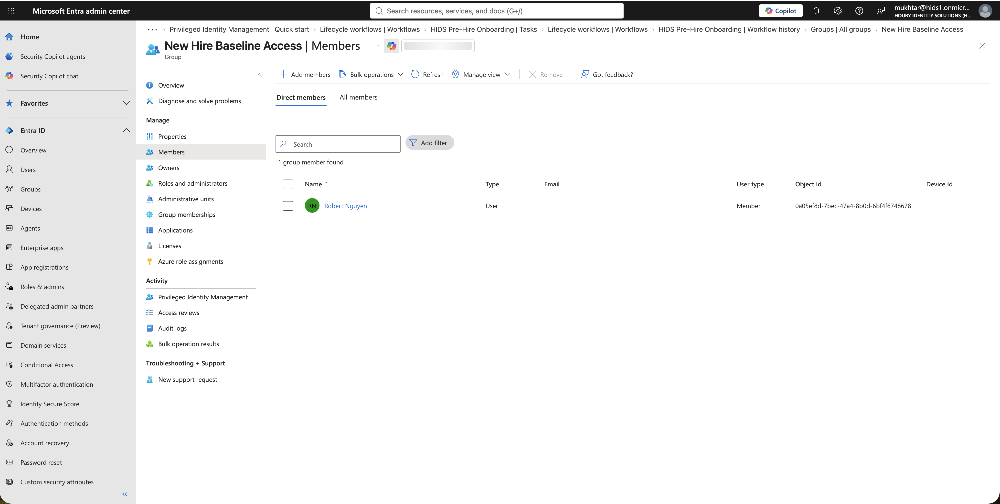

# Joiner: Attribute-Driven Provisioning and Onboarding Workflows

**Built with:** Microsoft Entra ID (Premium P2 + Entra ID Governance) · Dynamic groups · Lifecycle Workflows

I've spent years granting access by hand. Someone gets hired, you add them to the right groups, and the access they start with depends on who set them up and what they remembered.

I wanted to see what onboarding looks like when the directory does that work instead of a person: access that follows from who someone is, and a first-day process that runs on a schedule.

All users in this project are fictional and the tenant was built for it. Nothing here is production data.

## The risk

Manual onboarding is inconsistent. Two people hired into the same role on the same day can end up with different access, because two different admins set them up.

The quieter risk is that whatever grants access on day one is usually the thing nobody is watching later. A scheduled process that provisions people will keep provisioning, including people it shouldn't.

## What I built

**Attribute-driven groups.** 13 users across 6 departments, and 6 security groups whose membership is a rule instead of a list. Nobody gets added to these groups. The rule reads the user's department attribute and membership follows.

**A scheduled joiner workflow.** A Lifecycle Workflow that triggers 5 days before an employee's hire date, scoped to one department. It issues a Temporary Access Pass (a one-time, 8-hour first sign-in credential) and adds the new hire to a baseline access group.

## What I found

**Membership is a query, not a list.** I set an attribute on all 13 users at once and watched each group fill itself without touching any group. The attribute edit is the provisioning action.

**Configuring something isn't verifying it.** I checked that each group reported dynamic rules processing succeeded with the right member count instead of trusting the save confirmation. That habit mattered in every project after this one.

**The workflow can't add people to a dynamic group.** The group picker in the joiner task won't offer dynamic groups, because their membership comes from a rule, not an assignment. I created a separate assigned group for baseline new-hire access so the workflow had something it was allowed to grant.

**The first run failed on data, not configuration.** The Temporary Access Pass is emailed to the new hire's manager, because a new hire has no mailbox yet, and the manager had no email address on file. That task failed, and the group add after it was canceled. An email problem blocked a new hire's access. I set the manager's email attribute, let the workflow continue past a failed notification, re-ran it, and both tasks completed. Onboarding automation is only as good as the directory data it reads.

**The joiner kept running after the person left.** This is the finding that matters most, and it's written up in [Leaver](../leaver/). A scheduled joiner ran against a terminated, disabled account and gave its baseline access back, and reported zero failures.

## What I'd recommend

Drive baseline access from attributes rather than assignment, so access is consistent for everyone in the same role.

Make the joiner workflow aware of employment status. A scheduled workflow that only checks a hire date will happily re-provision someone who has already left.

Verify each control against what the platform reports, not against the save confirmation.

## What I'd do differently in a real environment

The department attribute would come from the HR system through automated provisioning, not from an administrator typing it. A free-text field that decides access is a data quality problem waiting to become a security problem.

## Screenshots

| | |
|---|---|
|  | Setting an attribute on all 13 users at once. The attribute edit is the provisioning action. No group is touched. |
|  | The IT group populated from its rule. Nobody was assigned manually. |
|  | The joiner workflow triggers 5 days before the hire date. |
|  | The workflow's group picker refuses dynamic groups, which is why baseline access needed its own assigned group. |
|  | The first run failed because the manager had no email address for the Temporary Access Pass to go to, and the group add behind it was canceled. |
|  | After the fix, the new hire was added to baseline access by the workflow, not by a person. |

**Related:** [Mover](../mover/) · [Leaver](../leaver/) · [Access Requests](../access-requests/)
