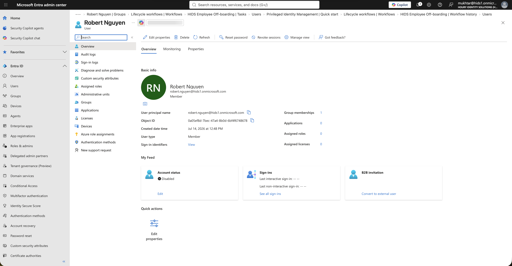
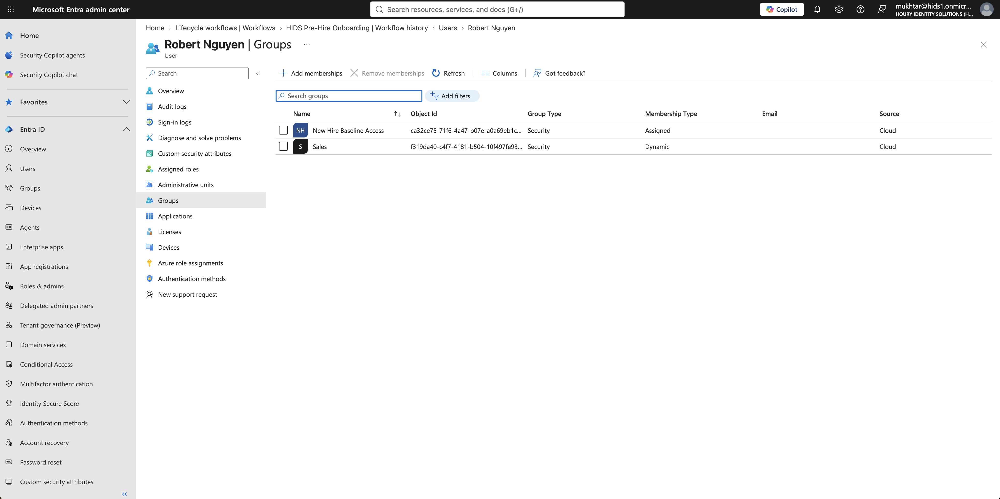
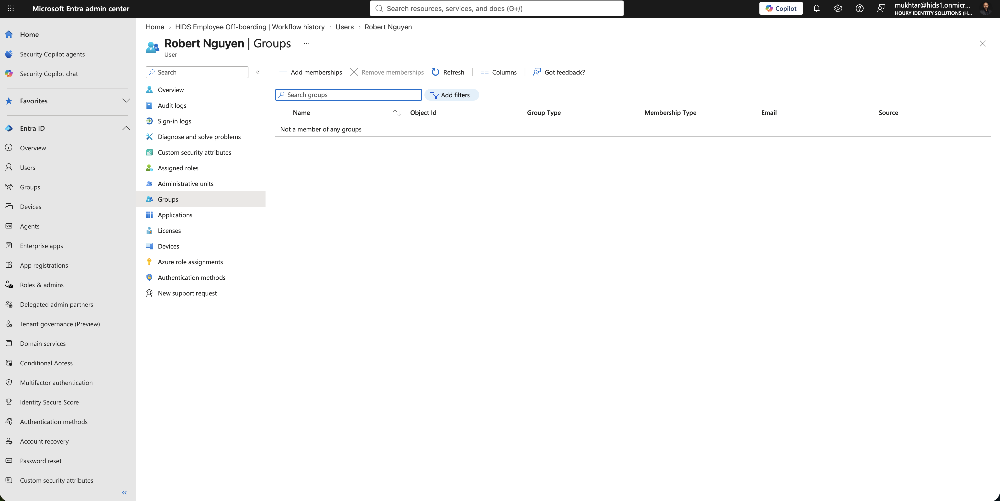
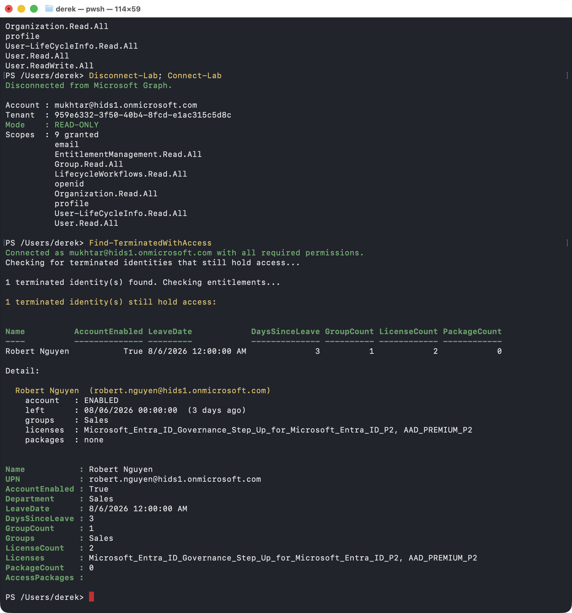
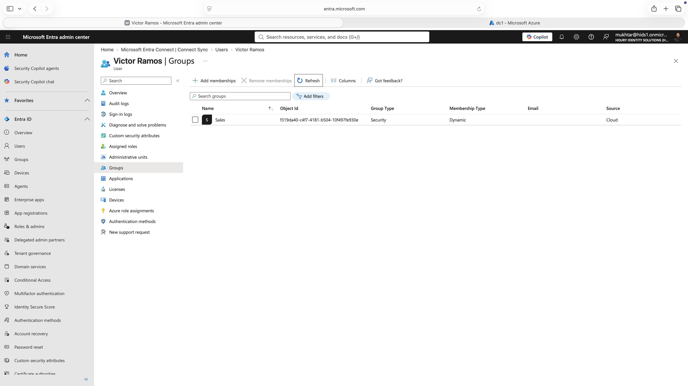
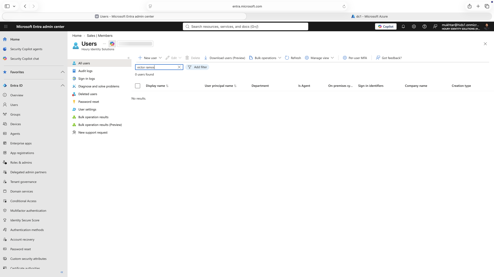

# Leaver: Off-boarding That Says It Worked, and How to Catch It When It Didn't

**Built with:** Microsoft Entra ID (P2 + Entra ID Governance) · Lifecycle Workflows · Microsoft Graph PowerShell SDK · Active Directory Domain Services · Microsoft Entra Connect Sync

When somebody leaves, the business assumes their access is gone. The evidence for that assumption is usually a status page saying the job finished.

I tested off-boarding 3 ways: an automated leaver workflow in the cloud, a help desk termination in on-premises Active Directory, and a PowerShell detection script to find the cases where either one failed.

All users in this project are fictional and the tenants were built for it. Nothing here is production data.

## The risk

If a termination status can say success while access is still live, then every termination record in the company is unverified. Nobody is going to re-check them by hand, and an auditor asking "prove these people no longer have access" has nothing to look at.

An off-boarding failure that nobody detects is indistinguishable from an off-boarding that worked. Both look like a closed ticket.

## What I built

**An automated leaver workflow.** A Lifecycle Workflow that disables the account, revokes refresh tokens, removes groups, Teams and licenses, and emails the manager, in that order: stop new sign-ins first, then kill existing sessions, then remove what they could reach. No deletion, so the identity is preserved for investigation or rehire. It runs alongside the scheduled [joiner](../joiner/) workflow.

**A hybrid termination.** A user disabled in on-premises Active Directory and then moved to a Disabled Users folder, the 2 steps a help desk normally takes.

**A detection script.** [`Find-TerminatedWithAccess.ps1`](scripts/Find-TerminatedWithAccess.ps1) checks every terminated identity against the 3 places access actually lives: group memberships, licenses, and access package assignments. It exports to CSV so the output can go to an auditor as evidence.

## What I found

**The off-boarding said it worked and it didn't.** 6 of 6 tasks completed, zero failures, account disabled. The user still had a group. The "remove user from all groups" task can't remove a dynamic membership, because that membership isn't an assignment, it's a rule that still matches. The log said success and the access was still sitting there.

**Then the onboarding put it back.** 8 and a half hours later the scheduled joiner ran against that same terminated, disabled account and re-granted its baseline access. Both workflows reported zero failures. Nothing anywhere connected the two events, and nobody would have gone looking.

**The fix was the attribute, not the group.** Adding a task that clears the attributes driving membership took the account to zero groups. You can't remove rule-based access by removing the person from the group. You have to remove the reason they qualify.

**Disabling in Active Directory doesn't remove access either.** In the hybrid test the cloud account went to Disabled, and the user kept his dynamic group membership and both of his licenses, because the group rule checks his department and nobody clears that when someone leaves. He couldn't sign in, and that was the entire effect. I reached the same conclusion from a completely different direction, which is probably the real lesson.

**The second step of a normal off-boarding deletes the account.** Moving him to the Disabled Users folder put him outside the sync scope, so Entra Connect read him as gone and deleted the cloud identity. The tenant went from 25 users to 24. No warning, no confirmation. The step that looks like filing paperwork is the destructive one.

**The obvious check is the wrong check.** "Terminated but still enabled" is what almost everyone writes, and it would have returned zero rows during the workflow failure above, because that account *was* disabled. Disabling doesn't remove entitlements. You have to look at what someone still holds, not whether they can sign in.

**A missing permission looks exactly like a clean result.** Microsoft Graph returns the termination date as empty when you lack the permission to read it, not as access denied. A report built on that would show zero terminated users and look perfect. I made the script hard-stop instead of producing a report it isn't allowed to produce correctly.

**I corrected something I'd already published.** I had concluded the platform truncates a timestamp. Testing a second write path proved the platform keeps the full value and one workflow task was doing the truncating. Narrower, more useful, and I left the original reasoning visible rather than quietly editing it.

## What I'd recommend

Off-boarding has to clear the attributes that drive entitlement, not just remove group assignments and disable the account. Anything computed from a rule survives a removal task.

Treat workflow completion status as a claim and verify it against the directory. 6 of 6 tasks complete told me nothing.

Check entitlements, not account state. "Terminated but still enabled" misses the exact failure it's meant to catch.

Any script that produces audit evidence should check its own permissions and refuse to run rather than emit an incomplete report.

## What I'd do differently in a real environment

I'd want the joiner and leaver workflows to know about each other. The failure here wasn't that either one broke. It was that a scheduled joiner ran against a terminated account and nothing existed to stop it.

Nobody would move a terminated account into an out-of-scope folder without knowing it deletes the cloud identity. That needs to be written into the off-boarding procedure, not discovered.

The detection script would run on a schedule against a service principal with certificate authentication, not interactively from a laptop, and it would reconcile against the HR system rather than the directory's own leave date.

## Change records

Written up the way an identity team would hand them to an auditor: subject, baseline, what each step actually did, and a control verification table.

- [`CHG-001`](evidence/CHG-001-leaver-robert-nguyen.md): a termination that reported 6 of 6 tasks complete while leaving access in place, then had that access restored by a scheduled joiner 8.5 hours later. 4 controls pass, 7 fail.
- [`CHG-003`](evidence/CHG-003-leaver-victor-ramos.md): a hybrid termination run the way a help desk runs one. 4 controls pass, 7 fail.

## Screenshots

| | |
|---|---|
|  | Account disabled as expected, group memberships went from 2 to 1 instead of 0. The run still logged 6 of 6 complete. |
|  | 8.5 hours later the scheduled joiner gave the terminated account its baseline access back. |
|  | After clearing the attributes driving membership, the dynamic group finally released the account. |
|  | The detection script's first real run. A terminated identity holding a group and 2 paid licenses. A groups-only check would have missed the licenses. |
|  | Hybrid: a terminated user, disabled on both sides, still holding the same dynamic group membership. |
|  | Zero users found. Moving the account to an out-of-scope folder deleted the cloud identity outright. |

**Related:** [Joiner](../joiner/) · [Mover](../mover/) · [Directory Sync](../directory-sync/) · [App Consent and Least Privilege](../app-consent-least-privilege/)
