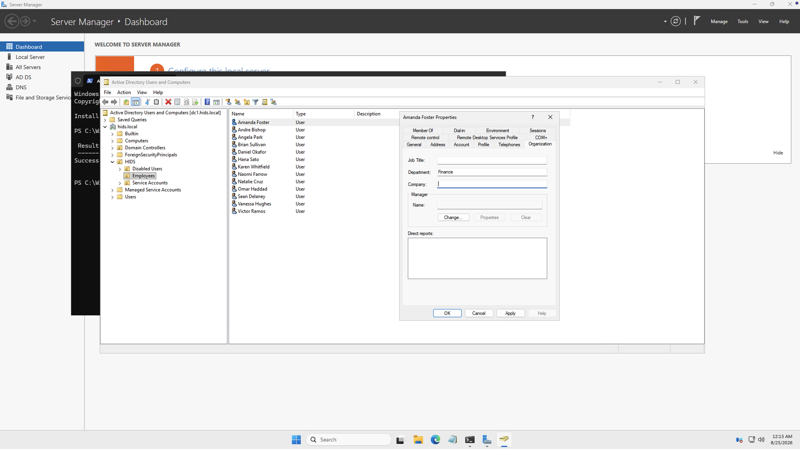
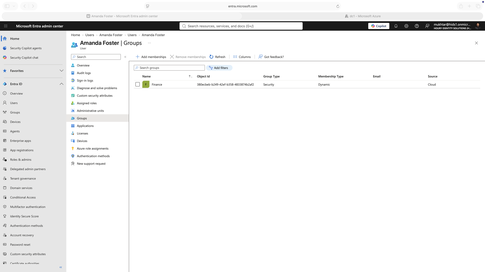
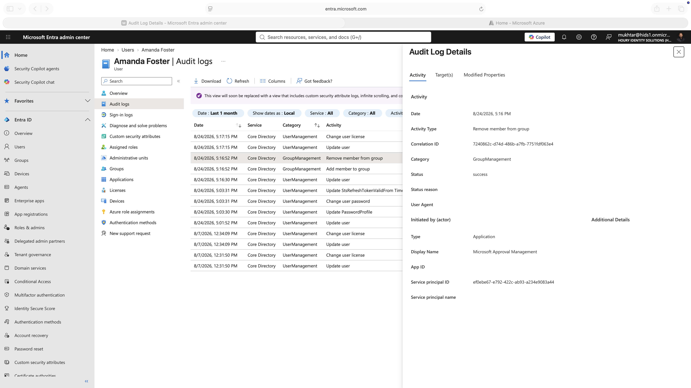
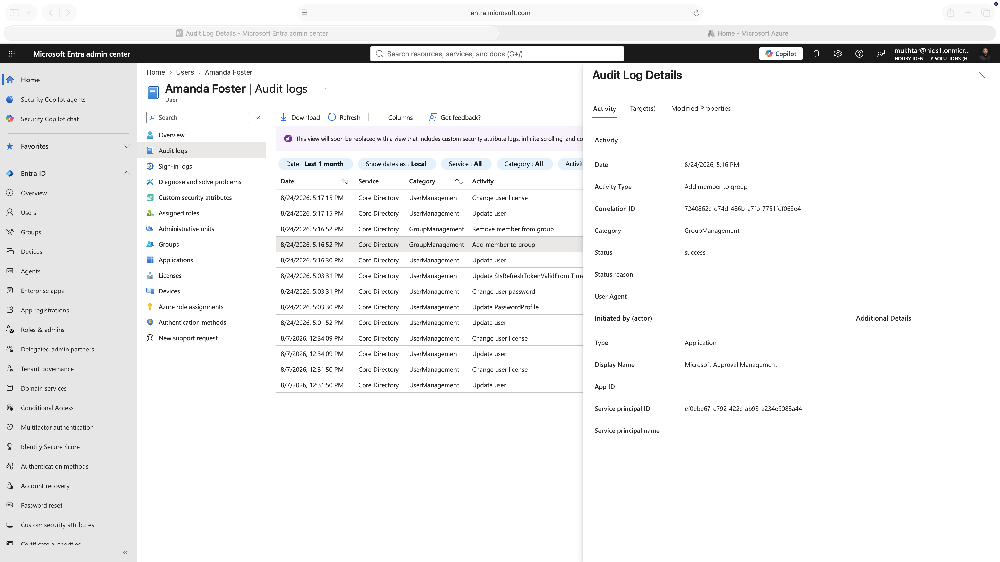

# Mover: Role Changes and Silent Entitlement Swaps

**Built with:** Microsoft Entra ID (Premium P2) · Dynamic groups · Active Directory Domain Services · Microsoft Entra Connect Sync · Entra audit logs

Someone changes teams, and you're supposed to remember to take the old access away. Usually nobody does, because nobody complains about having too much. That's where most stale access comes from.

I tested role changes in both of my environments: a cloud-only tenant, and an on-premises Active Directory synced into the cloud.

All users in this project are fictional and the tenants were built for it. Nothing here is production data.

## The risk

The classic mover risk is accumulation. People carry entitlements from a role they left two years ago, and every access review finds the same thing.

Automation fixes that, and creates the opposite risk. When access is driven by an attribute, one edit to that attribute can replace everything a person can reach, with no request, no approver, and nothing that looks like an access change.

## What I built

**Cloud-only.** Groups whose membership is driven by the department attribute (see [Joiner](../joiner/)). I edited a user's department and watched what happened to their groups.

**Hybrid.** A user whose department lives in on-premises Active Directory, synced to Entra ID. I changed her department in AD from Sales to Finance, the way a help desk would after an HR ticket, and traced the result through the cloud audit logs.

## What I found

**Access follows the attribute.** In the cloud-only tenant I edited a user's department and watched the matching group pick them up without anyone touching the group. When someone moves teams, their old access goes away because the rule stops matching, not because somebody remembered.

**A membership count can't tell you access changed.** In the hybrid test her group membership count read 1 before and 1 after. What actually happened is one group dropped her in the same operation another group picked her up. Everything she had access to was replaced and the number I was watching never moved.

**The audit trail proves it, if you know where to look.** I only proved it was one operation because the removal and the add share the same correlation ID. Every actor on those events was an application, not a person. Nobody approved this change, because to the system it wasn't an access change at all.

**The person making the change can't see its effect.** The department was edited by someone in Active Directory who never signs into the cloud. The access was granted and removed in Entra ID. A change made in one system produced effects in another system that person can't see.

## What I'd recommend

Treat attributes that drive access as access controls. A change to department should be reviewed the way a group change would be.

Alert on group membership events, the adds and removes individually. A count will hide a swap.

Anything genuinely privileged shouldn't be attribute-driven at all. Put it behind an [access request](../access-requests/) with approval and expiry, where the grant is a decision somebody made rather than a value in a field.

## What I'd do differently in a real environment

The department change would come from the HR system, not a help desk edit, and I'd want a record linking the HR event to the access change it caused.

## Change record

Written up the way an identity team would hand it to an auditor: subject, baseline, what changed, approval trail, and a control verification table.

- [`CHG-002`](evidence/CHG-002-mover-amanda-foster.md): a role change that replaced every entitlement a user had, with no request and no approver. 4 controls pass, 3 fail.

## Screenshots

| | |
|---|---|
|  | The department changed in on-premises Active Directory, the way a help desk would do it. |
|  | After sync she's in the Finance group and out of Sales. The membership count never changed. |
|  | The removal from Sales. The actor is an application, not a person. |
|  | The add to Finance carries the same correlation ID as the removal. One operation replaced her access. |

**Related:** [Joiner](../joiner/) · [Leaver](../leaver/) · [Directory Sync](../directory-sync/)
