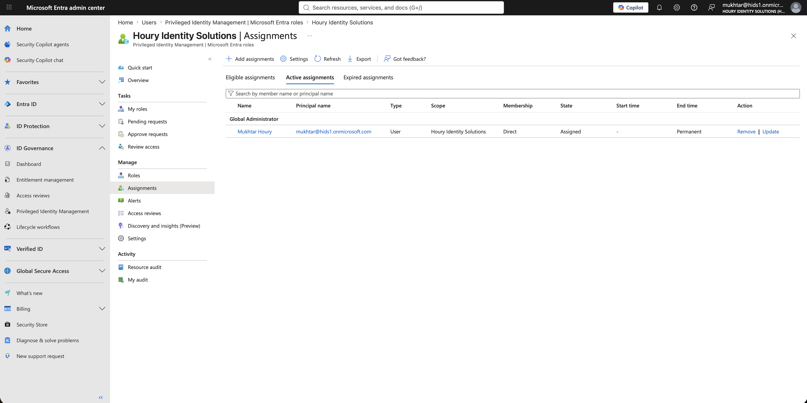
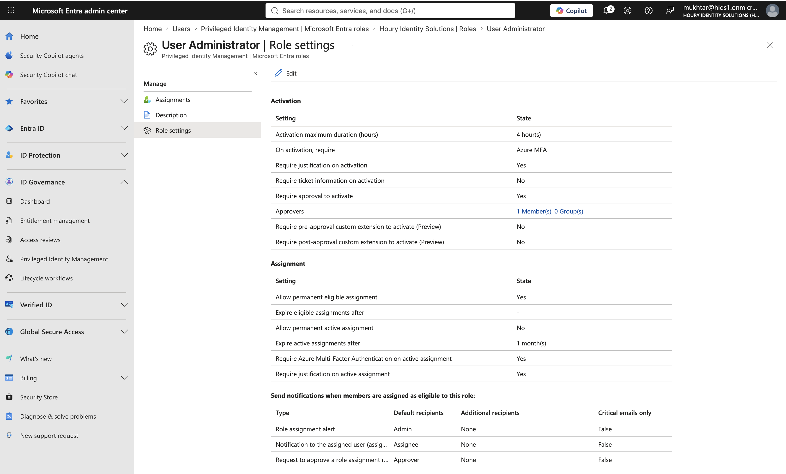
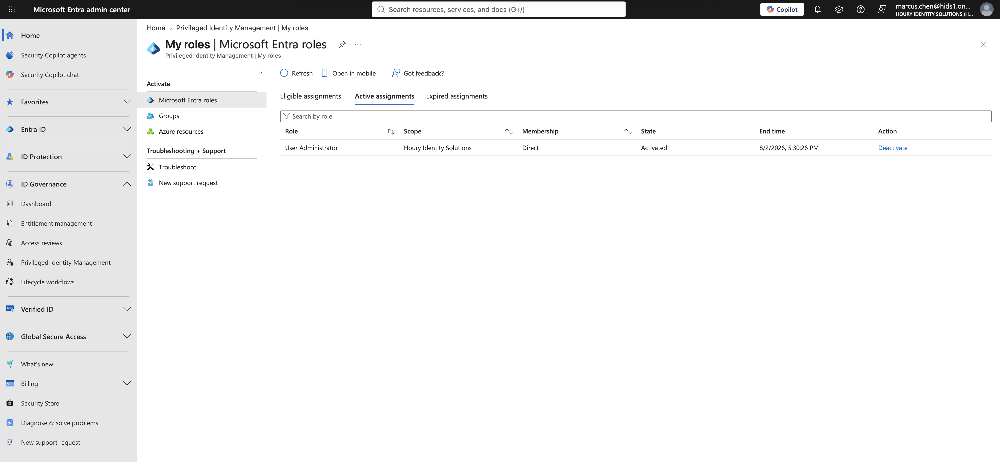
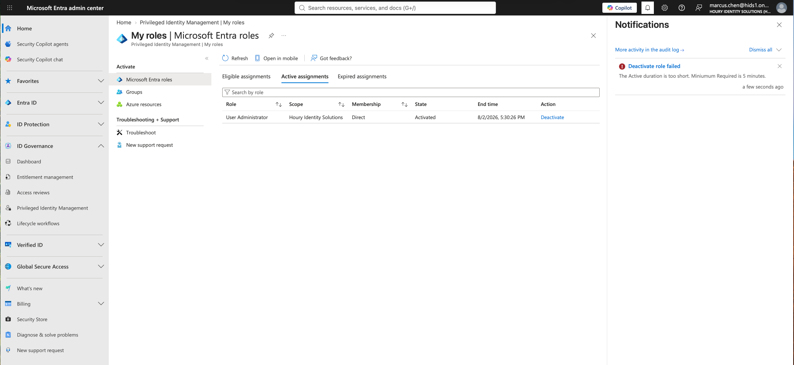
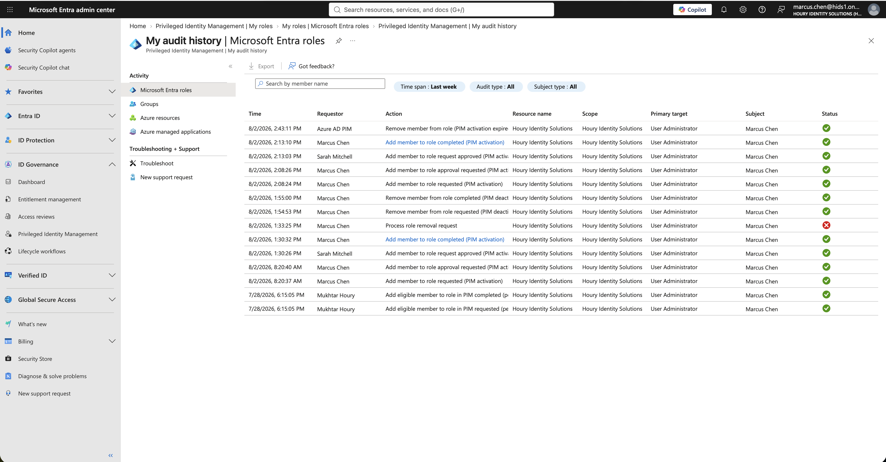

# Privileged Access: Just-in-Time Admin with Privileged Identity Management

**Built with:** Microsoft Entra ID (Premium P2) · Privileged Identity Management (PIM) · PIM access reviews

Standing admin access is the account an attacker wants most. Someone who holds User Administrator all day, every day, is a risk even on the days they never use it.

I wanted admin access to be something a person has to ask for, someone else has to approve, and the system takes away on its own.

All users in this project are fictional and the tenant was built for it. Nothing here is production data.

## The risk

The default state in most tenants is permanent admin roles that nobody reviews. Even with PIM turned on, the default settings still allow exactly the standing privilege PIM exists to remove.

## What I built

An IT user is **eligible** for User Administrator instead of holding it. A second IT user is the approver, so no one can grant themselves the role.

I hardened the role settings, because the defaults had 2 real gaps:

- **Approval was off.** Out of the box an eligible user activates on their own. MFA and a justification make the activation traceable, but nobody authorizes it. I turned approval on and named the approver.
- **Permanent active assignment was allowed.** Nothing stopped an admin handing out the role permanently. I turned that off, and set any direct active assignment to expire after 1 month and require MFA.
- **Activation lasts 4 hours,** down from the default 8, which was a full workday of privilege.

Then I added a quarterly access review of everyone who holds or is eligible for the role.

## What I found

**Eligible doesn't mean "has."** While he was eligible, the user's profile showed 0 assigned roles. An eligible assignment means someone can request elevation, not that they hold it, and that distinction is the whole product. It also means latent privilege is invisible on the user's page.

**PIM ships with accountability, not authorization.** Those are different controls and they get confused constantly. The default gives you a record of who activated. It doesn't give you anyone saying yes.

**The approver can't be a group that includes the requester.** The obvious approver group was IT, and the person requesting the role is in IT. Selecting it would have let him approve his own privilege escalation, a segregation of duties failure that passes a configuration review and fails an audit.

**The clock starts at approval, not at the request.** The request sat pending for 5 hours. PIM discarded the original window and gave him 4 hours from the moment it was approved.

**You can't drop privilege instantly.** Deactivating 3 minutes after activation failed with a 5-minute minimum. The failed attempt is in the audit log with a red mark, so attempts are recorded alongside successes.

**A finished activation leaves no trace on any assignment screen.** After the role expired, the user looked exactly like he did before he ever activated. The full history of who held admin and when lives only in the PIM audit log, and the final revocation is signed by PIM itself, not a person.

**The access review has to include eligible users.** I scoped the review to "all active and eligible assignments." A review of active holders only would have listed nobody and certified that the tenant has no User Administrators.

## What I'd recommend

Make every admin role eligible, not active, with approval required and an approver group that excludes the people it approves for.

Turn off permanent active assignment. Leaving it on means PIM is installed but not enforcing anything.

Review eligible assignments, not just active ones, and pull activation history from the audit log, because that's the only place it exists.

## What I'd do differently in a real environment

I'd tie activation to a Conditional Access authentication context (compliant device or phishing-resistant MFA) instead of plain MFA.

I also didn't convert the tenant's only Global Administrator to eligible. With no second break-glass account, that's how a tenant becomes unrecoverable. In a real tenant there would be at least 2 emergency access accounts first, and then every Global Administrator would go through PIM.

## Screenshots

| | |
|---|---|
|  | Before: no eligible assignments, and one permanent Global Administrator. |
|  | Role settings after hardening: approval required, named approver, 4-hour activation, no permanent active assignment. |
|  | Elevation granted only after approval and MFA, with a 4-hour limit counted from approval. |
|  | Deactivation inside 5 minutes is refused. |
|  | The full request, approval, activation and expiry chain, which only exists in the PIM audit log. |

**Related:** [Access Requests](../access-requests/) · [Access Reviews](../access-reviews/) · [Conditional Access](../conditional-access/)
